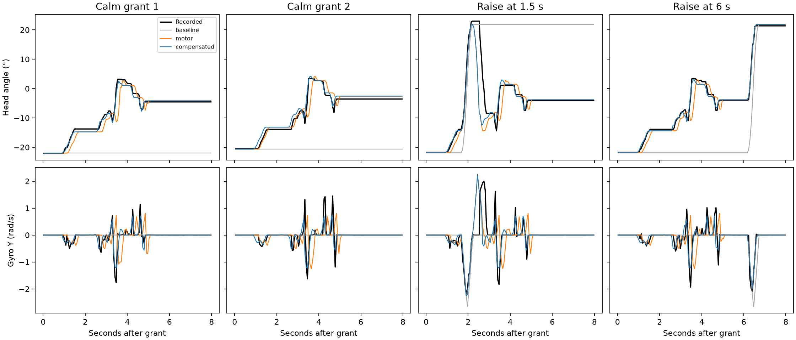

# Reproducing the docked wake through the canonical head motor

The motor-driven wake profile transfers to the held-out v1 robot. Using 200 ms of animation preview selected on two workshop A recordings, the simulated encoder matches workshop B's two uncommanded calm wakes to 0.76° and 1.21° RMS, versus 15.21° and 14.47° with the baseline. Simulated gyro error drops from 0.285 to 0.156 rad/s and from 0.333 to 0.267 rad/s. On A's third grant the encoder error drops from 15.90° to 0.99°. Both awake controls retain their baseline traces.

The command interaction exposes a more specific discrepancy. Raising the head six seconds after grant produces 0.72° RMS encoder error. Raising at 1.5 seconds produces 4.81° and 4.66° in the repeated trials, against 21.24° and 21.32° for the baseline. From 2.4 to 3.0 s after grant, just after physical action success, angle errors are 16.96° and 16.03°. From 3 to 8 s they fall to 0.84° and 1.33°. Full-trial gyro RMS barely changes on the first early raise and worsens on the second. The return from the SDK target to the ongoing wake movement needs its own timing and motor check before accepting a general wake implementation.

The source trajectory is the mean head displacement from the two training grants on workshop A. Each replay begins on the dock at its own recorded head and lift position. When the last pre-grant calm flag is set, a moving head target follows that displacement until 5.16 s. The canonical servo, command delay, rigid-body dynamics and sensor reporting produce every predicted angle and gyro sample. Only initial posture, calm flag and any timestamped +22° command come from the scored trace. The replay holds the last animation target after the clip. A head action takes precedence during its own simulated execution. If it completes while the clip is active, the next target comes from the current phase of the clip.

The baseline uses the ordinary simulator with the same initialization and explicit raises. The SDK-stream comparison reissues commandHeadAngle every 5 ms, which resets the ramp rate each time. The motor comparison streams position targets into the existing motor controller while retaining its ramp velocity. The compensated comparison uses the same controller, reading the prerecorded target trajectory ahead by a fixed interval. This preview is possible for a known animation. It never reads future samples from the scored trial. The interval minimizes mean head-angle RMS over the two training grants on a 0–300 ms grid in 50 ms steps. Gyro packets are independent outputs of the simulation; no gyro series is injected.

[All run scores](motor-scores.csv) · [Training grid](motor-fit.csv) · [Physical command interaction](../wake-raise/README.md) · [Reproducer](motor.mjs). Install the pinned web dependencies, run motor.mjs with Node, then run motor_plot.py with NumPy and Matplotlib. Each score covers eight seconds at the physical SDK receipt times. The baseline is the canonical v1 free-chassis dock model from 2ea39bb. The test harness supplies the candidate animation.
