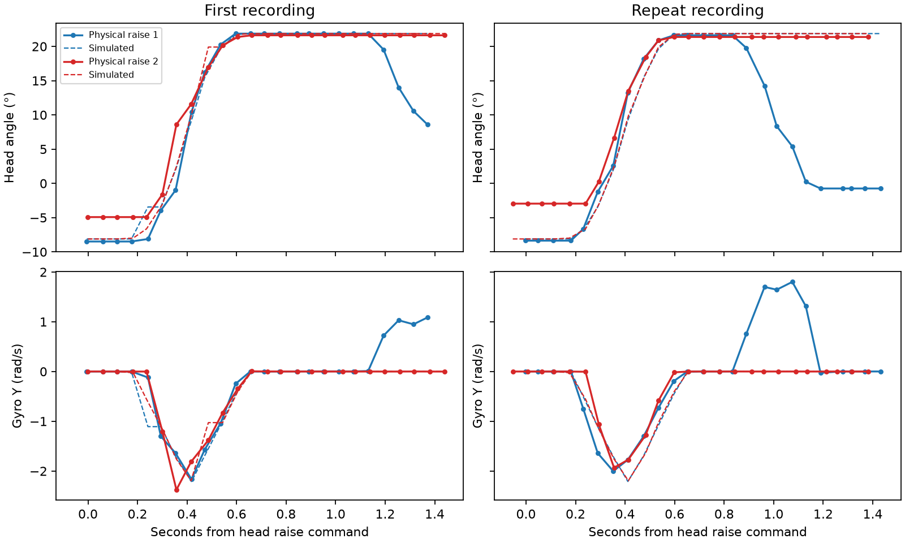
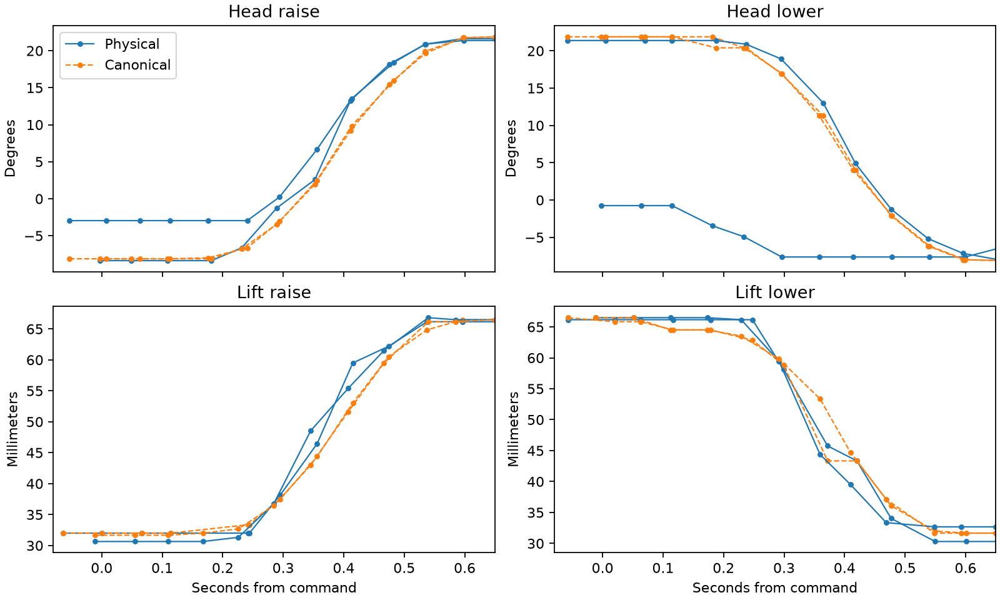

# The first head raise loses position during the hold

The clearest repeatable discrepancy appears **after** the unloaded head reaches its target. In two docked recordings of the same workshop robot, the first +22° command reached 21.87° and 21.62°. Before the subsequent lower command, the head had already returned to 8.60° and −0.74°, respectively. Those changes took 0.77 and 0.84 s from the first peak sample. On the second raise in each sequence, the last readings were still 21.62° and 21.38°. The canonical sim stayed at 21.87° in all four holds. The telemetry establishes the motion. The cause, including whether firmware commanded it, remains open.

This also accounts for missing head transit times. The physical head began some moves partway through the nominal range. Of the repeat's four head moves between fixed targets, only two span both thresholds in the commanded direction. Among those two, sampled canonical and physical transit estimates are 249 vs 224 ms raising and 243 vs 230 ms lowering. On all four lift moves the canonical estimate is slower by 17–44 ms. All six physical and simulated transit brackets overlap. These runs provide stronger grounds for investigating hold behavior than for changing either actuator's travel speed.

The frozen Vector 1 model at commit 152e83d used the free chassis, paired dock, contact42 scene, override and noise seed 42. It starts at the first measured encoder positions and receives the complete recorded command schedule. The installed SDK maps normalized lift height to 32 + 60 × height in mm. Simulated charger contact stays asserted throughout both runs. No parameter or time offset was fitted. Simulated reports are sampled at the latest available tick at each physical receipt. Thresholds are −5° and +18°, and 36 and 60 mm. The bracket spans the earliest and latest possible transit between adjacent reports assuming monotonic crossing on each interval. It excludes unknown SDK transport delay. Sampling is about 60 ms. Two sequences on the same robot do not establish a fleet-wide hold behavior.

[Crossing estimates and bounds](canonical-transits.csv) · [Physical repeat](repeat.md). Install the web dependencies, run canonical_replay.mjs with Node, then run score_canonical.py with NumPy and Matplotlib.
