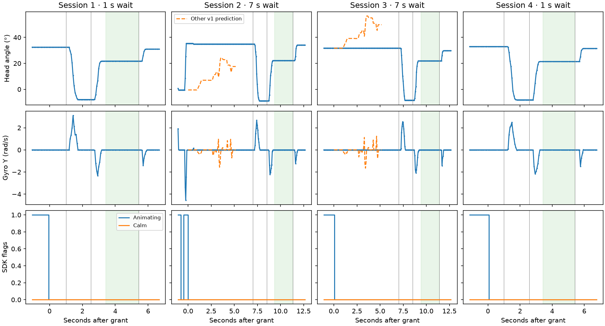

# First head raise after a docked override with calm mode already clear

Waiting seven seconds gave the same hold outcome as waiting one second. In four new sessions, the first +22° raise held its encoder position for all 134 reports collected between action completion and the restore command. Peak absolute gyro Y during any hold was 0.00275 rad/s. The SDK animating bit was clear throughout each hold. In contrast, the first raises in the [two earlier immediate-connection sessions](../canonical-comparison.md) lost 13.3° and 22.4° before the next command.

This comparison used a passive SDK connection, one second of observation, explicit override, then a wait of 1, 7, 7 or 1 seconds in successive sessions. Each time the robot went to −8°, waited 0.6 seconds, went to +22°, held for two seconds after success, and received its original head angle. Green shading marks the hold. Vertical lines mark head commands. There were eight seconds between connections. All 723 reports indicated dock contact. All four final battery queries confirmed platform contact at 3.549 V. No wheel commands were issued. One wheel-speed report reached 8 mm/s during the second session.

**Does the other v1 robot's wake motion transfer?** Workshop A's [command-free grants](../../docked-head-20261126/grants/README.md) began in calm power mode. Here the calm flag was clear in all 73 pre-grant samples. For the two seven-second waits, we tested workshop A's published two-session mean angle and gyro displacement on the first 5.2 seconds after grant, before any head command. That waveform predicts motion that is absent. With displacement anchored to the last pre-grant encoder reading, angle RMS errors were 13.83° and 13.48°, versus 0.46° and 0.00° holding that reading constant. The figure's dashed curves show the original median-baseline convention. Session 2 had a large *pre-grant* animation, so its one-second baseline median is misleading. Both baseline choices are in the CSV.

These runs rule out an unconditional first-raise excursion on workshop B. They do not isolate calm-mode exit as its cause. The earlier immediate-connection recordings omitted the status flags, and a passive-first connection changes the experiment. A discriminating follow-up would capture both connection paths starting from a verified calm state.

[Scores](scores.csv) · [Capture](capture.py) · [Analysis](analyze.py). Run the analysis from this repository with NumPy and Matplotlib. Four raw SDK receipt streams are adjacent to the script.
