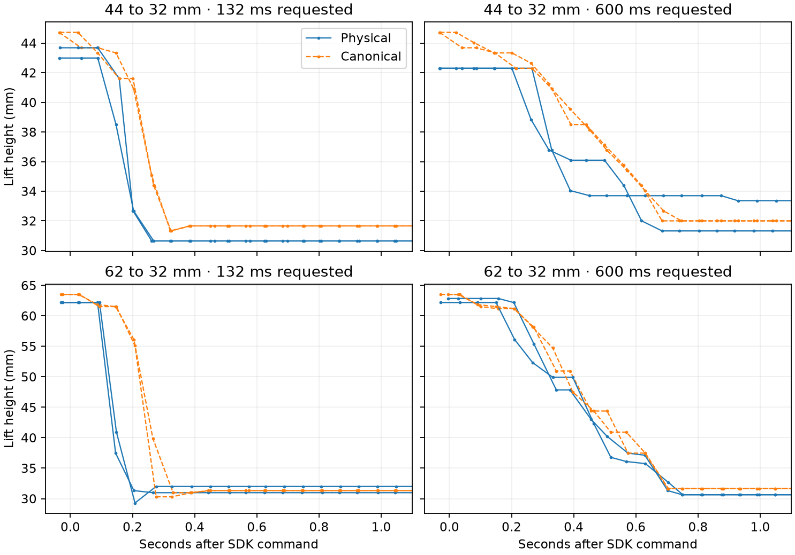

# Docked lift lowering on a workshop Vector v1

Eight physical lowers compared with the canonical browser MuJoCo model at 01047d3. The robot stayed on the charger platform in all 475 state packets. All eight prepositions and eight lowers returned SDK success. The robot finished at 30.65 mm with 3.549 V on the dock.

| Requested move | Requested time | Physical time through middle 60%, ms | Canonical, same trials, ms |
|---|---:|---:|---:|
| 44 to 32 mm | 132 ms | 80, 36 | 80, 71 |
| 62 to 32 mm | 132 ms | 42, 54 | 74, 55 |
| 44 to 32 mm | 600 ms | 108, 347 | 316, 311 |
| 62 to 32 mm | 600 ms | 296, 296 | 276, 312 |

For the four 132 ms commands the simulated encoder crossed 20% of requested travel 81, 103, 90 and 44 ms later than the physical encoder, in trial order. The 62 mm slow lowers were repeatable through the middle of the stroke. At 44 mm the two physical slow lowers had disjoint crossing-time bounds of 0–124 and 236–360 ms. A single duration correction would hide that variation.

## Measurement

Time zero is host-side SDK command issue. The physical series uses host receipt time with median packet spacing of 60 ms. The replay uses the recorded cue schedule, initializes from the first reported pose, and samples model state at the same packet times. Each plotted point is a packet. The frozen model executes the prepositions itself. Physical preposition heights ranged from 42.30–43.69 and 62.19–62.85 mm, versus 44.73 and 63.52 mm in replay. Those offsets contribute to threshold timing. Transport delay, encoder sampling and motor response remain combined in this comparison.

Scores use the first downward crossings of 20% and 80% of nominal commanded travel. The point estimates interpolate adjacent packets. The low and high bounds allow each crossing anywhere in its packet interval. This raised-start trial exercises the 132 ms command used during wake. An actual wake transition has a different starting state. No constants were fitted. The second workshop v1 was unreachable for replication.

## Reproduce

With web dependencies installed, run `node replay.mjs` from this folder and then `python3 compare.py` with NumPy and Matplotlib. Inputs and outputs are [physical packets and SDK events](recording.csv), [sampled replay](replay.csv), and [per-trial scores and bounds](scores.csv).
