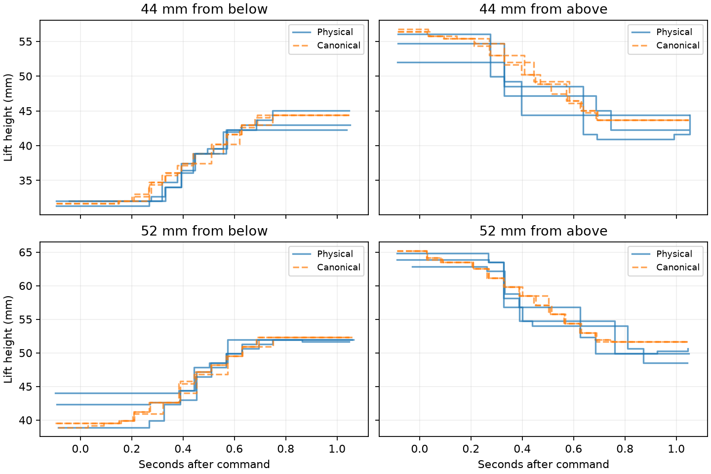

# Docked lift endpoints approached from both directions

Twelve physical moves crossed two targets (44 and 52 mm) with approach from 12 mm above or below, three times per combination. All used 600 ms. The installed SDK maps normalized commands linearly from 32 to 92 mm, which the collector checked before moving. All 25 actions including prepositions and cleanup returned success. All 713 packets reported dock contact. The last reported lift height was 33.36 mm after the 32 mm cleanup command and the final battery query verified dock contact at 3.549 V.

| Target | Approach | Median physical endpoint minus target | Median canonical endpoint minus target |
|---|---|---:|---:|
| 44 mm | Raise | −1.00 mm | +0.38 mm |
| 44 mm | Lower | −1.70 mm | −0.31 mm |
| 52 mm | Raise | −0.02 mm | +0.33 mm |
| 52 mm | Lower | −2.08 mm | −0.36 mm |

These fixed-time readings use median lift height 0.9–1.1 seconds after each SDK command. At 52 mm all three physical lowers were below all three raises in this window. The three lowers had yet to return success. Measuring after SDK acknowledgement reduces the median separation from 2.06 to 1.38 mm. [Post-return comparison](../return-times/README.md) At 44 mm the two groups overlapped. A difference by direction can therefore matter even with the same requested travel and target.

We estimated the median physical-minus-canonical endpoint offset on the six 44 mm training trials. The common offset and the separate raising and lowering offsets all rounded to −1.38 mm. On the six 52 mm holdouts either correction reduced mean absolute endpoint error from 1.26 to 0.81 mm. A retrospective cross-check on the preceding session’s four lowers per target gave 1.64 → 0.43 mm at 40 mm, but 0.42 → 1.47 mm at the minimum (32 mm). Applying a global offset would degrade the lower endpoint. This check adjusts predicted endpoint readings only. It does not establish a mechanical cause or reproduce the intermediate pauses.

Run `node replay.mjs approach-direction/` from the parent folder and `python3 compare.py` from this folder with NumPy and Matplotlib. [Endpoint scores](endpoints.csv) · [Physical SDK packets](recording.csv)
