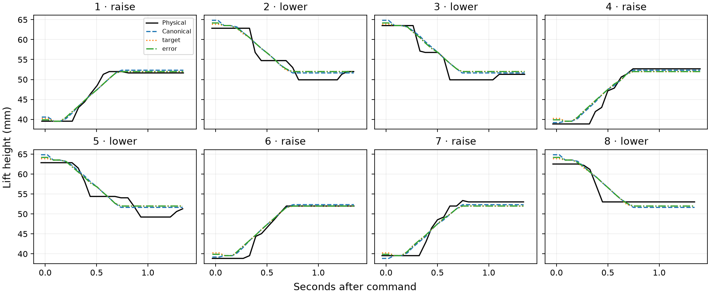

# Does the stock derivative term explain the lift overshoot?

The reference hardware controller computes derivative power from the change in **position error** over successive ticks. The canonical MuJoCo actuator damps joint velocity. A moving target contributes to the former. We tested this distinction on twelve earlier strokes and eight independent approaches to 52 mm. All 84 replayed actions across the four variant runs completed successfully (including prepositions and cleanup; see individual returns).



| Replay | Earlier raise RMSE | Earlier lower RMSE | Independent raise RMSE | Independent lower RMSE | Independent flag MAE |
|---|---:|---:|---:|---:|---:|
| Canonical | 1.324 mm | 1.965 mm | 1.154 mm | 1.747 mm | 189 ms |
| Target derivative added | 1.256 mm | 2.039 mm | 1.262 mm | 1.756 mm | 189 ms |
| Sampled error derivative | 1.282 mm | 2.046 mm | 1.251 mm | 1.755 mm | 189 ms |

The target variant retains the canonical velocity damping and adds the target-motion term. The error variant sets the lift actuator's velocity damping to zero and adds the full sampled error difference. Both use the model's hardware gain (3000), 5 ms period and proportional gain (3) to convert derivative power to an equivalent servo target offset. The derivative addition is suppressed when both target and measured angle occupy the same 5° end band. The error variant includes derivative power in the integral-decay decision. These probes retain the model's joint angles, gearbox and MuJoCo position actuator. They do not emulate a measured motor current or a discrete encoder feedback loop. [Reference hardware control law](https://github.com/kercre123/victor/blob/669ec7499a7084640b57706a7937884a6568be50/robot/supervisor/src/liftController.cpp#L828-L893)

The derivative variants improved the raises in the earlier recording only. Both slightly worsened the independent lowering trajectories, and neither moved the first reported in-position packet on any independent trial. The overshoot and variable settling time are still unexplained. No production constant changed.

From the parent directory, with web dependencies installed, reproduce with:

```sh
for mode in error target; do
  for src in approach-direction status-52; do
    dest="derivative/$src-$mode"
    mkdir -p "$dest"
    node replay.mjs "$src/" "" 0 "$dest/" "$mode"
  done
done
python3 derivative/compare.py
```

The plotting step uses Matplotlib. Scores use the same 1.4 s encoder window and flag checks as the earlier friction study. [Per-stroke scores](scores.csv)
