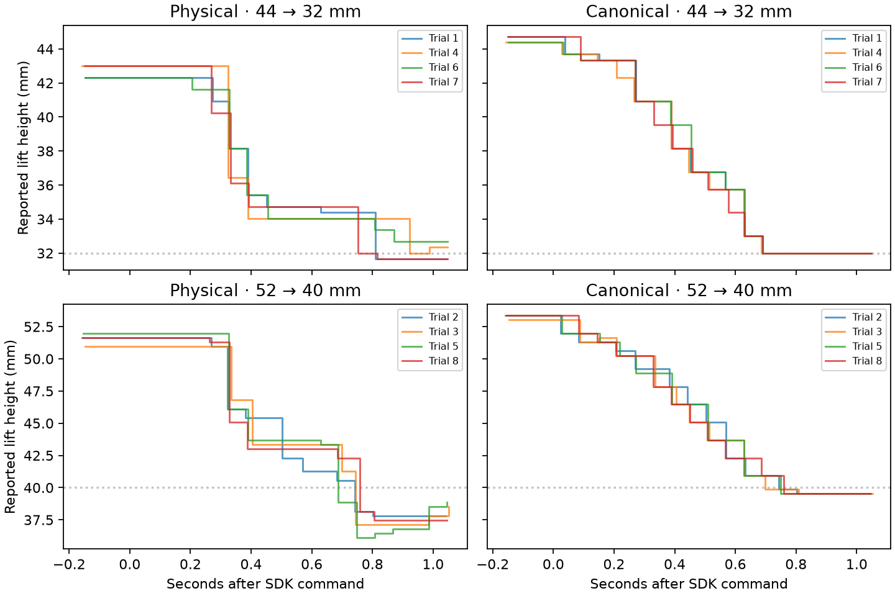

# Intermediate lift pauses with the target raised

Eight docked v1 lowers interleaved four 44 → 32 mm strokes with four 52 → 40 mm strokes. Requested duration was 600 ms for every lower. Both the physical robot and canonical replay completed the command sequence on the dock. A final cleanup command lowered the physical lift to 31.32 mm and the final battery query confirmed platform contact at 3.549 V.

| Target | Longest intermediate dwell per physical stroke (ms) | Corresponding model dwell (ms) | Physical final reported error (mm) |
|---|---|---|---|
| 32 mm | 117, 476, 291, 297 | 57, 59, 116, 119 | −0.3 to +0.7 |
| 40 mm | 63, 224, 178, 236 | 57, 59, 58, 57 | −2.5 to −1.5 |

A pause also occurred above the elevated target. Three of its four physical trials held one intermediate encoder value for at least 178 ms, then resumed descent. At 32 mm the longest dwells were at 34.0–34.7 mm. At 40 mm they were at 41.3–43.7 mm. Raising the target also revealed consistent endpoint undershoot. The simulated endpoint errors were 0.0 and −0.5 mm respectively. This points to an error in the reported motion profile as well as endpoint tracking. The recordings cannot identify whether the cause is in motor control, mechanical friction, or encoder reporting.

Dwell is the time between the first and last consecutive equal readings at least 1 mm below measured start and 1 mm above command target, bracketed by descent on both sides. Thus it is a lower bound on an observed plateau at SDK resolution. Its physical and canonical locations can differ. Final error uses the median height 0.9–1.1 s after command issue. Four repeats per condition, one physical robot, no fitting.

Run the parent replay with `node replay.mjs elevated-target/`, then run `python3 compare.py` here with NumPy and Matplotlib. [Per-stroke scores](scores.csv) · [Raw SDK packets](recording.csv)
