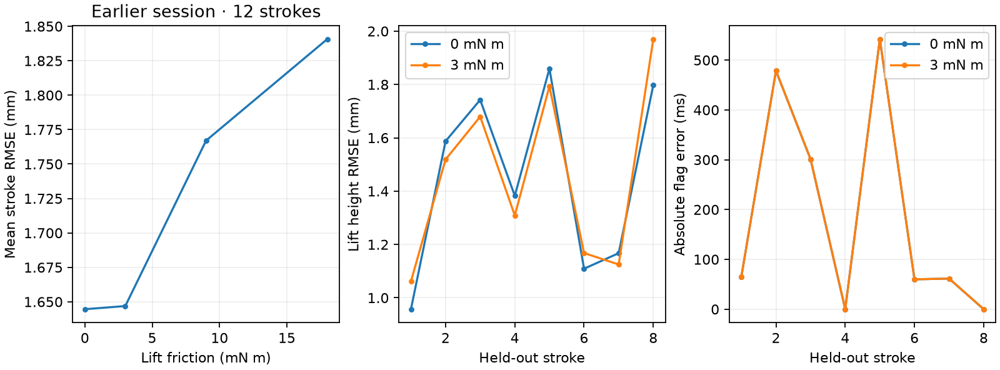

# Does passive lift-joint friction explain the slow lowers?

Adding Coulomb friction to the lift hinge improved the earlier lowering trajectories slightly, at the cost of larger raising errors. On the independent 52 mm session, the best nonzero candidate changed mean stroke RMSE from 1.450 to 1.453 mm and left first in-position packet timing error at 189 ms. We retained the canonical hinge.



| Passive friction torque | Earlier raises, RMSE | Earlier lowers, RMSE | All twelve strokes, RMSE |
|---:|---:|---:|---:|
| 0 mN m | 1.324 mm | 1.965 mm | 1.645 mm |
| 3 mN m | 1.404 mm | 1.890 mm | 1.647 mm |
| 9 mN m | 1.653 mm | 1.881 mm | 1.767 mm |
| 18 mN m | 1.753 mm | 1.929 mm | 1.841 mm |

The experiment varied only MuJoCo's lift_joint frictionloss in the canonical dock scene. The sweep spans the proportional torque corresponding to the 1.5° completion band (about 16 mN m). These are sensitivity values; physical gearbox friction has not been measured. Each replay followed every recorded command, including prepositions, on one continuous simulation clock. All replay actions completed and every paired packet reported dock contact.

A stroke's score is height RMSE over the first 1.4 s after the timed command, using physical SDK receipt times. The selection criterion is the arithmetic mean across the twelve 44 and 52 mm approaches. Zero had the lowest mean. We compared it and the best nonzero candidate, 3 mN m, on the independent eight 52 mm approaches. The first in-position packet after the flag cleared landed on the same sampled packet for both settings in every held-out trial. A symmetric passive friction term of this form does not explain the delayed lowering flag.

With the web dependencies installed, from the parent directory run the following. The unmodified baseline traces are in the two physical session folders.

```sh
for torque in 0.003 0.009 0.018; do
  mkdir -p "friction/train-$torque"
  node replay.mjs approach-direction/ "" "$torque" "friction/train-$torque/"
done
python3 friction/score.py --select
mkdir -p friction/test-0.003
node replay.mjs status-52/ "" 0.003 friction/test-0.003/
python3 friction/score.py
```

The final command requires Matplotlib. [Per-stroke scores](scores.csv)
