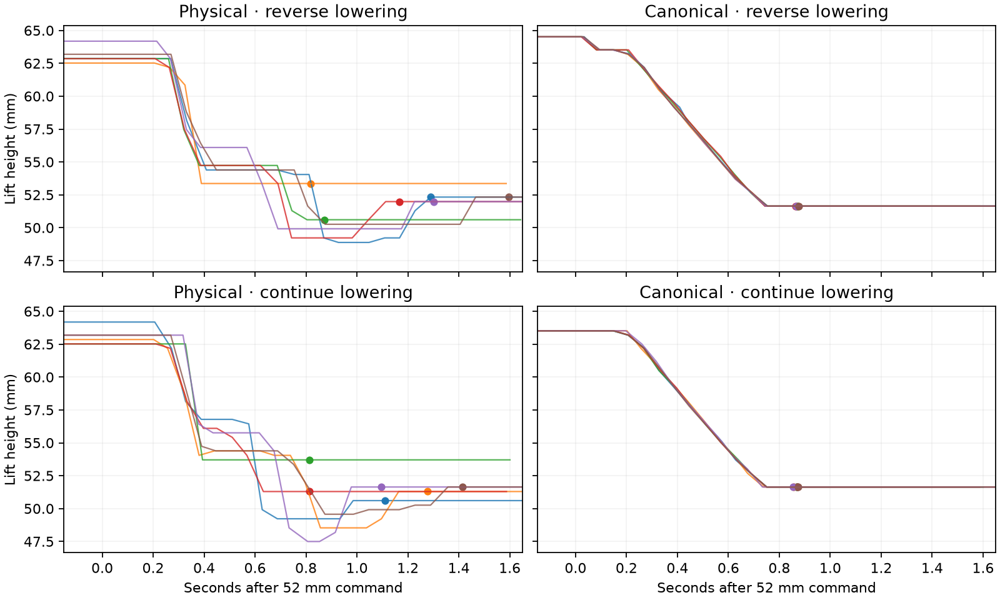
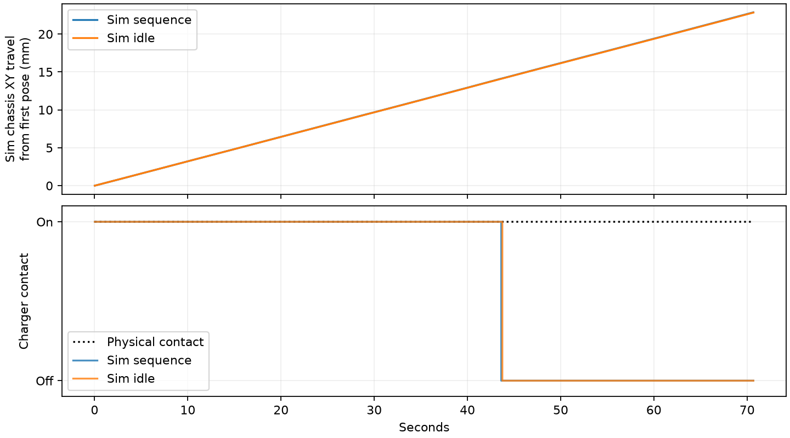

# Does the preceding lift direction explain slow lowers?

Twelve docked 64 → 52 mm moves crossed two histories. In six, the fork reached 64 mm by rising from 52 mm and then reversed. In six it lowered from 76 mm and continued lowering. Each approach to 64 mm and each scored lower requested 600 ms. The initial preposition used default duration. We paired adjacent trials with counterbalanced order. All 37 physical actions succeeded. All 1,179 SDK packets showed dock contact, including the final packet after cleanup (32.68 mm lift). The final query confirmed platform contact at 3.549 V.

Median first in-position report was 1,228 ms after a reversal and 1,103 ms after continued lowering. Reversals took longer in five of six adjacent pairs. The median paired difference was +181 ms, with individual differences from −461 to +354 ms. The two starting-height distributions overlapped (medians 62.85 and 63.02 mm). The canonical median paired difference was +2 ms, subject to the dock-contact discrepancy below.

Using the other five pairs to predict each held-out pair, direction-specific medians gave 236 ms mean absolute error, versus 235 ms using one common median. A linear model using measured starting height gave 246 ms. On the four lowers of the preceding separate session these errors were 180, 192, and 197 ms respectively. Previous direction is insufficient for a reliable fixed correction on this robot.

## The canonical robot creeps on the dock even at idle

The simulated chassis advanced 22.87 mm along world X over 70.7 s. Electrical contact first went false at 43.62 s, while the model still reported being on the platform. A second canonical replay with identical initialization and zero issued commands advanced 22.83 mm and first lost contact at 43.75 s. The two endpoint displacements differed by less than 0.04 mm. Both remained on the simulated platform for the entire run. This isolates an idle dock-support discrepancy independent of the tested lift sequence. The physical SDK maintained charger contact throughout. There was no independent physical XY measurement in this experiment. Simulation scores carry a per-trial contact indicator because the later strokes ran under different contact conditions.

From the parent directory, run `node replay.mjs history-52/`. From this folder run `node dock.mjs sequence`, `node dock.mjs idle`, `python3 compare.py`, and `python3 plot_dock.py` with web dependencies, NumPy and Matplotlib installed. [Per-stroke scores](scores.csv) · [Held-out pair predictions](prediction.csv) · [Separate-session check](separate-session.csv)
