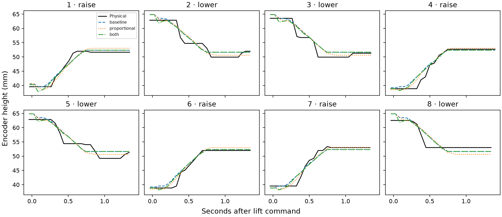

# Lift motor power scale

The stock HAL converts clipped controller power into a signed integer with a zero offset. Syscon scales it into PWM timer counts. Its 10% threshold sets the lift-driven flag used by the encoder diagnostics. Smaller commands that quantize to a nonzero timer count can still drive the motor. The source does not establish a 10% mechanical breakaway threshold. [HAL conversion](https://github.com/kercre123/victor/blob/669ec7499a7084640b57706a7937884a6568be50/robot/hal/src/hal_motors.cpp#L107-L113) · [Timer and driven flag](https://github.com/kercre123/victor/blob/669ec7499a7084640b57706a7937884a6568be50/robot/syscon/src/motors.cpp#L112-L150) · [PWM application](https://github.com/kercre123/victor/blob/669ec7499a7084640b57706a7937884a6568be50/robot/syscon/src/motors.cpp#L232-L265)

For zero speed and zero integral, the canonical 0.6 N m/rad servo reaches its 0.060 N m cap at 0.10 rad error. The firmware proportional gain of 3 commands only 0.30 normalized power at that error. We tested whether treating the model cap as full-duty stall torque improves the observed settling time. This is an assumption about the actuator. Neither stall torque nor motor current was measured in these recordings.



| Variant | Servo stiffness (N m/rad) | Damping (N m s/rad) | Earlier raise / lower RMSE (mm) | Independent raise / lower RMSE (mm) |
|---|---:|---:|---:|---:|
| Canonical | 0.600 | 0.0120 | 1.324 / 1.965 | 1.154 / 1.747 |
| Scale proportional gain | 0.180 | 0.0120 | 1.567 / 1.888 | 1.038 / 1.761 |
| Scale both gains | 0.180 | 0.0036 | 1.364 / 1.951 | 1.117 / 1.741 |

Both variants keep the same torque cap. Scaling servo stiffness also scales torque from the existing integral target offset. Scaling both preserves the damping-to-stiffness ratio. All replay actions completed. The eight independent in-position transitions landed on exactly the same sampled packets for all three replays, with 189 ms mean absolute timing error. The modest changes in height error did not consistently transfer between the twelve earlier and eight independent strokes. We kept the canonical gains.

From the parent directory run the following with the web dependencies installed, then plot with Python and Matplotlib.

```sh
for mode in proportional both; do
  for src in approach-direction status-52; do
    dest="power-scale/$src-$mode"
    mkdir -p "$dest"
    node replay.mjs "$src/" "" 0 "$dest/" "" "$mode"
  done
done
python3 power-scale/compare.py
```

[Per-stroke scores](scores.csv)
