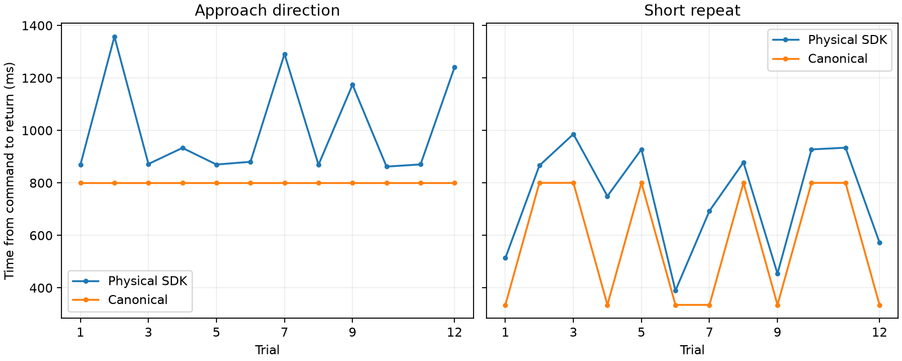

# SDK return times and lift height after acknowledgement

The earlier endpoint comparison sampled at 0.9–1.1 s after command issue. All three physical lowers to 52 mm were still awaiting SDK completion throughout that window. The SDK returned at 1.241–1.358 s, versus 0.862–0.933 s for raises to the same target. The canonical action completed at 0.800 s for all six.

Using the median physical encoder reading 150–450 ms **after** each return changes the estimated median lowering error from −2.08 to −1.39 mm. The raising error stays at −0.02 mm. The previously reported 2.06 mm separation at a fixed time therefore shrinks to 1.38 mm after acknowledgement (using unrounded readings). All three lowers still finish below all three raises. The largest individual change was a lower that measured 3.47 mm low at the fixed time and 0.70 mm low after return.

We replayed the original command schedules through the canonical browser model, scored every timed command, and checked every physical and simulated action result (including prepositions). Times on the physical side include the SDK request, robot behavior, and reply transport. Simulated time counts ticks from action start to completion. The difference cannot be assigned solely to motor latency.

| Target and requested time | Trials | Median SDK return | Median canonical return | Mean absolute difference |
|---|---:|---:|---:|---:|
| 44 mm, 600 ms | 6 | 871 ms | 800 ms | 122 ms |
| 52 mm, 600 ms | 6 | 1,087 ms | 800 ms | 293 ms |
| 32 mm, 600 ms | 6 | 928 ms | 800 ms | 120 ms |
| 32 mm, 132 ms | 6 | 543 ms | 335 ms | 227 ms |

Adding the 71 ms median offset from the 44 mm trials reduced mean absolute error to 225 ms for the held-out 52 mm trials, and to 51 ms and 161 ms for the independent slow and fast 32 mm trials. A common offset leaves the large direction-dependent return gap unexplained.

Run the parent replay for `approach-direction/` and `short-repeat/`, then run `python3 compare.py` here with NumPy and Matplotlib. [Per-trial timing](scores.csv) · [Physical heights in both windows](heights.csv)
