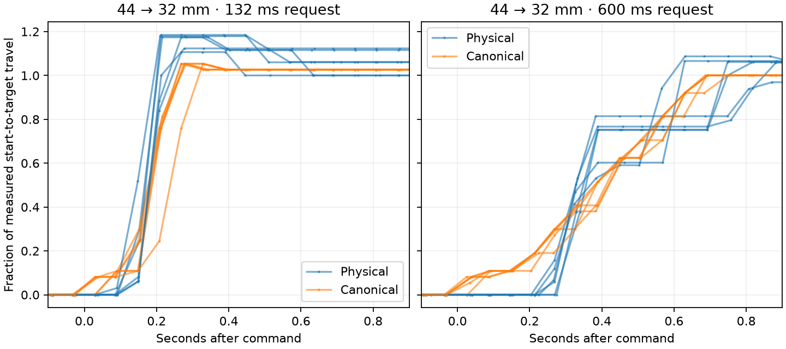

# Independent short-stroke replication

A fresh session on the same workshop v1 repeated 44 → 32 mm six times at each duration. All 24 actions (including prepositions) returned success, all 654 SDK packets showed dock contact, and the final battery query confirmed dock contact at 3.549 V. Median host packet interval was 60.1 ms. We replayed the cue schedule through the canonical browser MuJoCo model. Each trace uses its own measured starting height. The previous session supplied the two timing advances before this test.

| Duration | Travel crossing | Median absolute timing error (ms) | With previous advance (ms) |
|---|---:|---:|---:|
| 132 ms | 20% | 19 | 96 |
| 132 ms | 50% | 12 | 81 |
| 132 ms | 80% | 29 | 64 |
| 600 ms | 20% | 67 | 139 |
| 600 ms | 50% | 44 | 28 |
| 600 ms | 80% | 122 | 144 |

The 93 ms advance increased median absolute timing error at all three fast crossings. For the 600 ms command the 72 ms advance improved only the midpoint. At 80% travel, four of the six slow trials had physical and canonical crossing intervals that did not overlap. The same was true of one fast trial at 80%. The late portion of the short slow stroke warrants direct measurement.

Each threshold crossing is bracketed by adjacent reports and linearly interpolated. The scores give signed model-minus-physical errors, the extrema allowed by those packet brackets, and the signed errors after applying the frozen advance. These extrema do not include encoder calibration error or SDK transport latency. This replicate tests one robot on the same dock. The native 5 ms observer used on the other hardware has not been verified on this unit.

From the parent folder run `node replay.mjs short-repeat/` with the web dependencies installed. Run `python3 short-repeat/score.py` with NumPy and Matplotlib for the figure and [trial scores](scores.csv).
