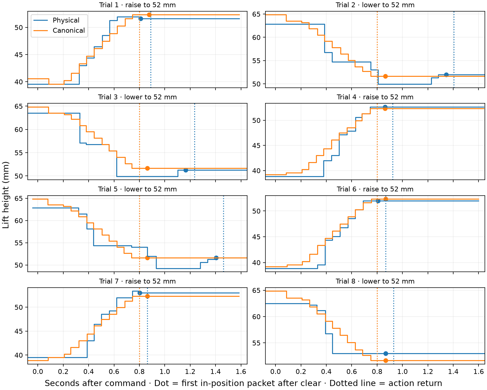

# Docked lift completion at 52 mm

Eight fresh 600 ms approaches to 52 mm alternate in counterbalanced order from 40 or 64 mm. The physical collector recorded the installed SDK's ROBOT_STATUS_LIFT_IN_POS bit (256) from the same state packet as the lift height. Every trial showed the bit clear and then set. All 564 physical packets reported dock contact, all actions succeeded, and the final battery check confirmed dock contact at 3.549 V after lowering the fork.

| Trace and direction | First reported in position, median | Action return, median | Return minus first report, median |
|---|---:|---:|---:|
| Physical raise | 809 ms | 878 ms | +62 ms |
| Physical lower | 1,254 ms | 1,320 ms | +62 ms |
| Canonical raise | 865 ms | 800 ms | −65 ms |
| Canonical lower | 865 ms | 800 ms | −65 ms |

Three physical lowers first reported in position at 1.164–1.404 s. The fourth did so at 0.866 s. All four raises first reported in position at 0.802–0.861 s. The approximately 446 ms median directional gap is already evident at the reported flag. After that packet, all eight physical returns arrived 58–78 ms later. Adding an SDK reply delay alone cannot reproduce this pattern.

The browser's internal action result became available at 800 ms in every replay. Its first in-position state seen on the recorded packet schedule followed the result. This exposes a second difference in externally observed event ordering. It combines model publication, observation cadence, and hardware SDK delivery. The negative interval does not imply the internal controller set its flag late. Neither flag nor return proves the fork was mechanically stationary.

All times are relative to command issue. Each first-set time is bracketed by its preceding clear packet in the scores. Durations use host receipt time on hardware and the canonical action tick clock in simulation. Model constants were frozen. Reproduce from the parent with `node replay.mjs status-52/`, then `python3 compare.py` here. [Per-trial timings and heights](scores.csv) · [Physical packets](recording.csv)
