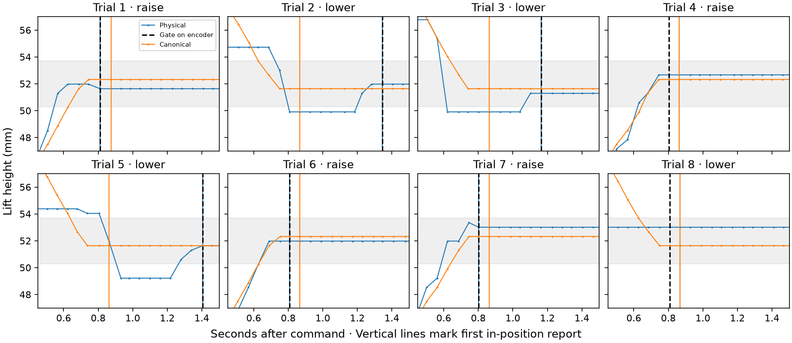

# Does the reported encoder trajectory explain the late lift flag?

On eight recorded 52 mm approaches the frozen simulator's first in-position packet had **189 ms mean absolute error**. Keeping the same final-command times, 1.5° tolerance and dwell rule, but supplying the measured lift encoder height gave **14 ms** with linear interpolation and **22 ms** holding each reading until the next packet.

The linear reconstruction identified the exact observed packet on all three delayed lowers (1.344, 1.164 and 1.404 s) and three of the four raises. It was one packet early on the remaining raise and the quicker lower. Holding each reading changed one delayed lower by one packet. No direction-dependent parameter or latency was fitted.

The simulator's downstream completion criterion can account for most of the directional discrepancy on these trials when given the physical lift path. Improving the predicted **height trajectory through the tolerance band** is the next mechanical or control-model target. This analysis uses the encoder and flag from the same physical packet stream. It is a diagnostic substitution, not an autonomous prediction or evidence of sub-packet accuracy.

## Calculation

The canonical replay records the first control tick after each command at which the delayed servo target equals the requested target. Starting at that tick, reconstruct shoulder angle from height using the model's 66 mm arm and 45 mm pivot height. Require angular error strictly below 1.5° for more than 100 ms, sampled every 5 ms. Report the first available packet at or after that decision. The plot shows linear interpolation. The table also includes a zero-order hold and a check using the published canonical height in place of the physical readings. Physical SDK receipt times are an approximation to acquisition time. The rule operates on higher-rate internal positions in the real controller and in the full simulation.

From the lift-duration directory run `node replay.mjs status-52/ gate/ready.csv`, then `python3 status-52/gate/check.py` with NumPy and Matplotlib. [Eight trials, both reconstructions](scores.csv) · [Canonical final-target ticks](ready.csv)
