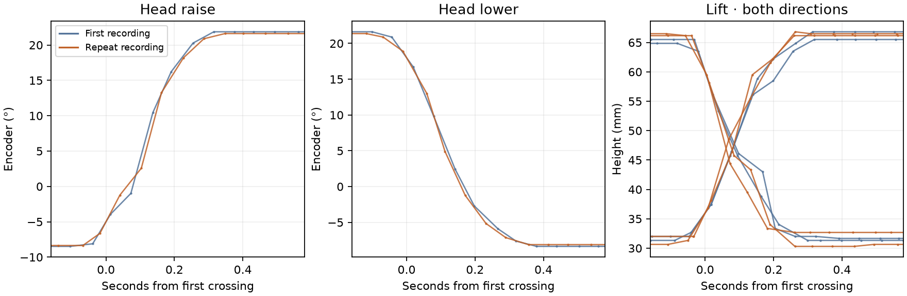

# Docked repeat on workshop B

The same robot repeated the earlier unloaded head and lift sequence 2 h 40 min later. All 250 SDK reports indicated dock contact. The largest absolute wheel-speed report was 1 mm/s. The SDK reported 3.549 V and charging inactive on the platform before and after the sequence.

| Transit | First recording (ms) | Repeat (ms) |
|---|---:|---:|
| Head −5° to +18° | 219 | 224 |
| Head +18° to −5° | 247 | 230 |
| Lift 36 to 60 mm | 169, 217 | 149, 176 |
| Lift 60 to 36 mm | 194, 195 | 178, 157 |

Only one raise and one lower per recording bracket both head thresholds after the command. Curves are aligned at the first threshold crossing. Times use linear interpolation between SDK receipts about 60 ms apart. The faster lift transits in this repeat do not establish a systematic change at this sample size. Workshop A was unreachable. No wheel commands were issued.

[Repeat recording](repeat-joints.csv) · [Matched transit times](repeat-transits.csv) · [Original protocol](README.md). Run repeat_analysis.py from this folder using NumPy and Matplotlib.
