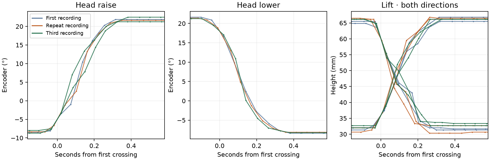

# Third docked head and lift recording

Workshop unit 1 repeated the same docked command sequence. Battery state reported on-platform at 3.549 V before and after. All transit times use the original encoder thresholds. Two head raises crossed the window in 229 and 251 ms, and one lower in 216 ms. Lift raises took 177 and 203 ms, and lowers 221 and 199 ms. Only moves with both crossings sampled are scored. A missing crossing is not evidence that the joint failed to complete the move.

[Raw SDK telemetry](third-joints.csv) · [All scored moves](third-comparison.csv) · [Analysis](third_analysis.py)
