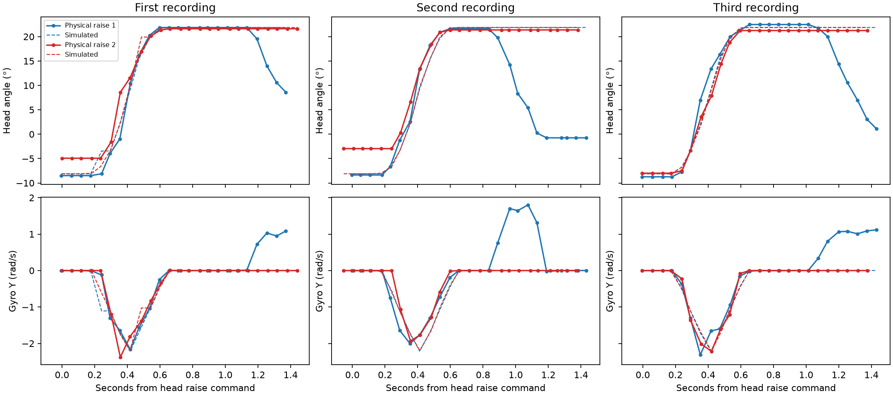
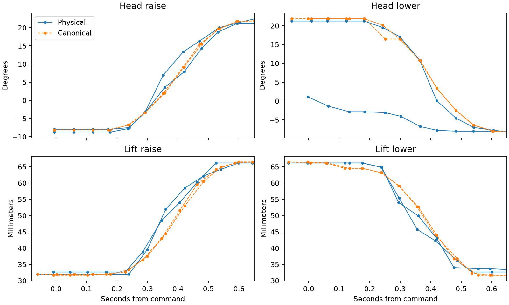

# The first raised head loses its position in three docked recordings

On the held-out third recording the first raise reached 22.48° and fell to 1.10° before the next command. The second raise reached 21.25° and held there. The first two recordings showed the same order dependence. The canonical browser replay held both raises near target. This is a repeatable hold error on this robot.

The robot received the same command sequence on all three occasions. Replays used main at 2c7eb02, the measured initial head and lift, seed 42, original receipt times and the unchanged Vector 1 dock scene. Both earlier simulated time series reproduced byte for byte. The gyro overlays share the command clock. The three recordings start after control grant and omit the pre-grant calm bit. Separate [timed wake experiments](wake-raise/README.md) support wake motion regaining the head after early commands. The initial calm state cannot be assigned retrospectively from these records alone.

| Third recording | Physical transit (ms) | Canonical transit (ms) |
|---|---:|---:|
| Head raise, first / second | 229 / 251 | 244 / 243 |
| Head lower after second raise | 216 | 245 |
| Lift raise, first / second | 177 / 203 | 202 / 191 |
| Lift lower, first / second | 221 / 199 | 211 / 205 |

The first head lower began below the upper crossing threshold. Across all three recordings, 19 of 24 commanded transits crossed both thresholds in the physical data. All 19 physical crossing-time brackets overlap their corresponding simulator brackets. At SDK resolution these intervals leave room for a speed error. In particular, the third recording has lift moves on either side of the model estimate, so it does not support a uniform lift speed correction.

[All crossing estimates and bounds](three-canonical-transits.csv) · [Held-out physical trace](third-joints.csv) · [Simulator trace](third-canonical-joints.csv). Run node canonical_replay.mjs followed by python score_canonical.py --include-third in this directory.
