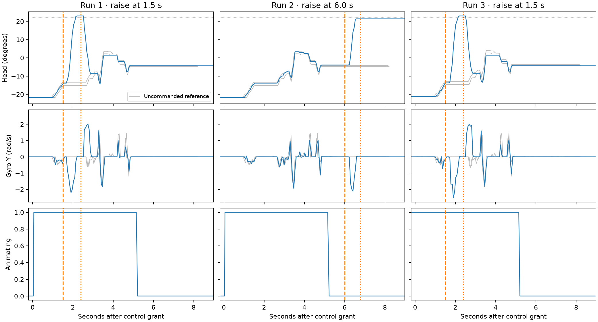

# A successful head raise during wake can lose its target

One docked v1 robot began each run in observed calm mode, granted SDK override, then received the same +22° raise at 1.5, 6.0 and 1.5 seconds after grant. All three actions returned success. The early raises reached the target and then lost it. The late raise held. Each recording ended with a restore command and a positive platform check.

Gray curves show the two [uncommanded calm wakes](../blind-grants/crossover.md) from this robot, aligned to grant time and shifted by the initial encoder difference. Vertical dashes mark the raise and dots mark its SDK response. The bottom row shows the animating status bit. All runs continued until nine seconds after grant before restoring the initial head angle.

| Raise time after grant | First sample within 2° of target | SDK success after command | Lowest angle after success | Final angle before restore |
|---|---:|---:|---:|---:|
| 1.5 s | 595 ms | 891 ms | −14.38° | −4.06° |
| 6.0 s | 533 ms | 772 ms | +21.38° | +21.38° |
| 1.5 s repeat | 581 ms | 893 ms | −13.40° | −4.06° |

A simple prediction distinguishes the two outcomes. From half a second after success through eight seconds after grant, continuing the original grant-aligned wake trace predicts the early runs within 0.87° and 1.04° RMS. Holding the +22° target would give 26.01° and 26.07° RMS. On the late run the target predicts within 0.62°, versus 25.87° for continuing the wake trace. The late comparison covers only about 0.73 s before that eight-second cutoff; the physical head held for the entire 2.2 s between success and restore.

For the canonical v1 simulator, the data support a head command temporarily taking precedence while the underlying docked wake sequence advances. When the command completes, an ongoing sequence can regain the head. A command issued after the sequence ends retains its target. This describes the observed behavior, not the internal firmware arbitration mechanism. Only a single head target, two command times and one robot were tested. All times are host SDK receipt times.

[Raw metrics](scores.csv) · [Capture](capture.py) · [Reproduction](analyze.py). Run analyze.py in this checkout with NumPy and Matplotlib to regenerate the plot and scores.
