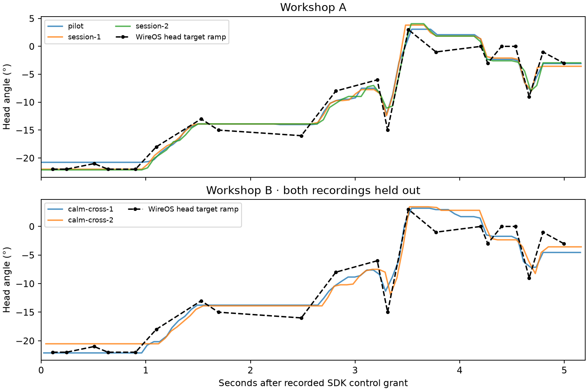
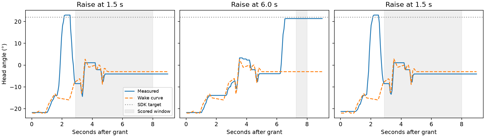

# The WireOS sleep-wake head track predicts the docked recordings

WireOS lists SDK control among the reasons to wake from sleep and enables the wake animation for that reason. The sleep-cycle behavior conditionally delegates to SleepingWakeUp, whose ConnectWakeUp trigger selects ag_gotosleep_wakeup. At the pinned externals commit that group has one animation, anim_gotosleep_wakeup_01. Its 19 head targets span 4.884 seconds. This chain identifies a candidate independently of encoder fitting. These trials did not record the robot’s live animation ID. [Wake reasons](https://github.com/os-vector/wire-os-victor/blob/3cec4844d24c4719b5b3892e4979494bcd260424/clad/src/clad/types/behaviorComponent/sleepingTypes.clad) · [Conditional dispatch](https://github.com/os-vector/wire-os-victor/blob/3cec4844d24c4719b5b3892e4979494bcd260424/engine/aiComponent/behaviorComponent/behaviors/sleeping/behaviorSleepCycle.cpp#L777) · [Trigger mapping](https://github.com/os-vector/wire-os-victor/blob/3cec4844d24c4719b5b3892e4979494bcd260424/resources/assets/cladToFileMaps/AnimationTriggerMap.json) · [Animation group](https://github.com/os-vector/wire-os-externals/blob/6aec7f1ddf341a898692768650fe945e334fb865/animation-assets/animationGroups/gotoSleep/ag_gotosleep_wakeup.json)

We interpolated linearly from the preceding target through each keyframe duration and held the target during gaps. A shared 110 ms shift relative to recorded grant minimized mean angle RMS over two training runs. It includes possible grant-clock offset and motor response. No amplitude scaling or per-run alignment was used. Over the first 5.2 seconds, held-out RMS was 1.53° on workshop A and 1.68° and 1.98° on workshop B. With no shift those errors were 2.85°, 2.83° and 3.16°.

The same curve predicts post-command position in both early-raise runs on B. Scoring from half a second after SDK success through eight seconds after grant gives 1.40° and 1.46° RMS for continuing the wake curve, versus 26.01° and 26.07° for holding +22°. For the late command, issued after the clip ended, holding +22° gives 0.62° RMS versus 24.38° for the final wake target. That late scoring window contains only 12 samples. The shaded windows exclude the immediate motor handoff and do not test torque, acceleration, or command latency.

This supports using the firmware head track as a motor-command source during a docked wake, with SDK commands temporarily taking precedence. The end of the underlying track matters for retention of the SDK target. Production integration still needs a motor replay with gyro validation. The asset has body and lift tracks as well, whose effects were not evaluated here.

[Uncommanded scores](scores.csv) · [Interrupted scores](interrupted.csv) · [Reproduction script](compare.py). Run the script with NumPy and Matplotlib. It retrieves the pinned archive and checks its SHA-256.
