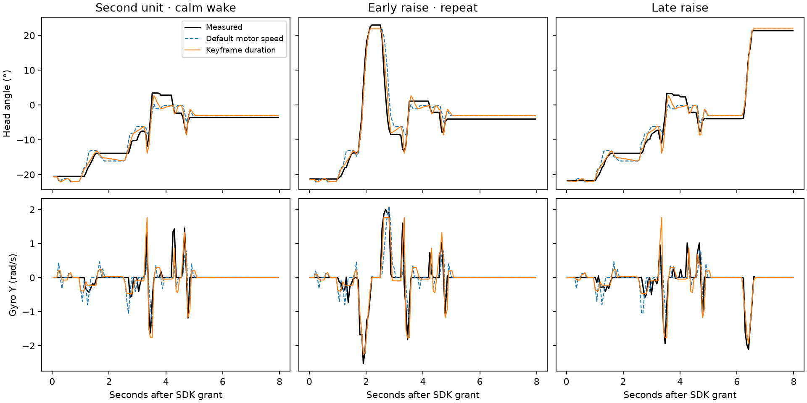

# Driving the canonical head motor with WireOS wake keyframes

The stock animation streamer sends a target angle and duration once, at the first tick of a head keyframe. The stock supervisor requests a velocity profile with a tenth of the duration for acceleration and another tenth for deceleration. We replayed that message schedule into the Vector 1 MuJoCo motor. Three runs per recording isolate the effects of enabling the clip and of honoring its durations. [Streamer](https://github.com/os-vector/wire-os-victor/blob/3cec4844d24c4719b5b3892e4979494bcd260424/cannedAnimLib/baseTypes/keyframe.cpp) · [Supervisor dispatch](https://github.com/os-vector/wire-os-victor/blob/3cec4844d24c4719b5b3892e4979494bcd260424/robot/supervisor/src/messages.cpp) · [Physical source comparison](README.md)

Every run starts at the final measured head and lift positions before the SDK grant, with seed 42, dock contact and the stock Vector 1 contact42 model. Clip time zero is grant time. No learned timing shift, lead, or per-run adjustment is used. The last pre-grant calm flag enables the clip. During a blocking SDK raise, keyframes continue to elapse; the first subsequent keyframe after the action completes and head-in-position is asserted can take over. The experiment uses rotational targets from the head track only. It does not command the animation's wheels or lift.

The timed driver uses the canonical discrete velocity profile with peak speed from the angular distance remaining in the command trajectory divided by 90% of the frame duration. It starts each new frame at zero profile speed. The stock generator can carry velocity into a new frame, so exact velocity-profile equivalence is unverified. Both encoder and gyro outputs come from the simulated robot. The gyro is never computed from the target curve.

[All trial and control scores](motor-scores.csv) · [Sampled traces](motor-traces.csv). From this directory run python compare.py --export-head-targets /tmp/wake-targets.json, node motor.mjs /tmp/wake-targets.json, then python motor_plot.py with NumPy and Matplotlib. The first command verifies the pinned archive checksum.

Over eight seconds, three held-out calm grants on two units had 1.35°, 1.82° and 1.46° encoder RMS with keyframe durations, versus 14.47–15.90° without the clip. Gyro RMS was 0.326, 0.365 and 0.243 rad/s respectively. Only the last improved against the no-clip gyro baseline. Both already-awake controls produced identical traces with the clip gated off. In the two early raises and one late raise the duration-aware model improved both signals versus the default-speed driver; full-window gyro RMS was 0.314, 0.303 and 0.268 rad/s respectively.

**Timing diagnostic.** On a common 0.3–4.9 s window, comparing the simulated gyro 40 ms earlier minimized RMS on both original training grants. Independently scored held-out grant minima were 40, 40 and 10 ms earlier; the three SDK raises favored 30 ms earlier. This suggests a phase contribution to the residual. Interpolation between roughly 60 ms SDK reports, unknown grant-to-animation timing, and motor dynamics all affect this estimate. The delay sweep was offline; the primary scores use untouched sensor timestamps. [Full phase sweep](gyro-phase.csv)

Freezing the 40 ms advance selected on training reduces held-out gyro error from 0.428 to 0.209 and 0.483 to 0.241 rad/s in two grants, but increases it from 0.319 to 0.399 in the third. That failed transfer argues against shifting all gyro timestamps.

**Integrated browser grant.** The fourth replay mode starts the simulator in the recorded calm state and calls its public requestControl method. The simulator dispatches the wake frames and handles interruption. On the ten recordings, all 1,340 encoder/gyro sample pairs matched the timed reference replay exactly. The two awake controls stayed still. With the production page built locally in Chromium, the Take control button woke the docked Vector 1 from −22°; after advancing the simulation another 3.8 s the encoder read −1.07° and charger contact remained asserted. The model currently covers the head track. The stock clip's lift, body, face, audio and lights were outside this validation.
