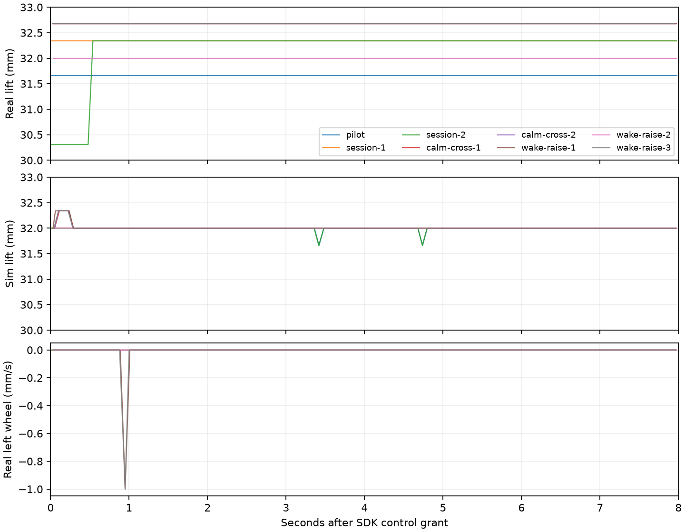

# The docked wake keeps the wheels still and targets the lift at 32 mm

The WireOS clip contains five drive pulses between 3.168 and 4.686 seconds, including 41 and −45 mm/s. On the charger the engine locks the body track unless the clip's name starts with an allowed prefix. The animation streamer also drops body-motion messages for an unlisted clip. The ordinary sleep-wake clip is unlisted; the onboarding wake has a separate, allowed prefix. This rule applies to animation playback on the platform. [Engine check](https://github.com/os-vector/wire-os-victor/blob/3cec4844d24c4719b5b3892e4979494bcd260424/engine/actions/animActions.cpp#L105) · [Prefix list](https://github.com/os-vector/wire-os-victor/blob/3cec4844d24c4719b5b3892e4979494bcd260424/resources/config/engine/animation_whitelist.json) · [Streamer check](https://github.com/os-vector/wire-os-victor/blob/3cec4844d24c4719b5b3892e4979494bcd260424/animProcess/src/cozmoAnim/animation/animationStreamer.cpp#L2077)

Eight recorded wakes on two workshop units yielded 1,072 SDK reports in the first eight seconds after grant. Both wheel encoders reported zero in all 125 reports inside the nominal pulse windows on the grant clock. Two isolated reports around 0.95 s had −1 mm/s on the left wheel. All reports had the charger bit set. This constrains the reported signals at SDK cadence. Subsample rocking remains possible.

The same clip requests 32 mm lift height over 132 ms at onset. The browser now sends that target once on grant. Seven physical runs reported constant lift height during the scoring window. One changed from 30.31 to 32.34 mm, first reported at +0.539 s. The simulated sensor reads near the target, with 0.00–0.67 mm lift RMS error across the eight replays. All starts were close to the lower stop, so these runs cannot establish transit time from a raised fork. A separate simulator test checks that an elevated lift lowers and a subsequent SDK lift command retains control.

In the same replays every simulated wheel report was zero and charger contact stayed asserted. Reported head angles matched the head-only replay sample for sample. The largest run-level RMS change in simulated gyro Y was about 0.00011 rad/s.

[Per-run scores](wake-joint-scores.csv) · [Sampled telemetry](wake-joints.csv). Run wake-joints.mjs with Node 24 and installed web dependencies, then wake_joints_plot.py with NumPy and Matplotlib.
