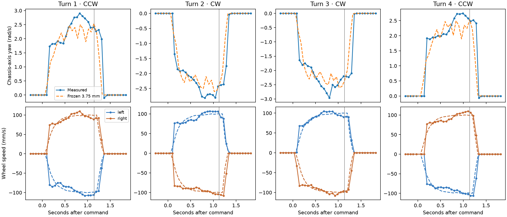

# Four 100 mm/s spins on the workshop table

The workshop robot ran two counterclockwise and two clockwise spins in CCW, CW, CW, CCW order, at opposite signed wheel targets of 100 mm/s for 1.13–1.15 s. The native undock was followed by 65 mm of commanded straight clearance and the native dock behavior after the final stop. The session ended on the charger and charging. There are 1,111 physical SDK packets including undock and return. The workshop tabletop is a third distinct hard surface. The requested test condition was stock treads; tread material and wear were not independently inspected in this run.

The candidate selected on unit 3 places effective contact 3.75 mm inward from each end with 48 mm physical axle spacing. It underpredicts steady chassis-axis yaw magnitude in all four held-out spins, with errors of 12.48%, 9.50%, 8.59% and 8.16% (RMS 9.83%). Mean measured rates span 2.51–2.63 rad/s in magnitude versus 2.30–2.34 simulated. After dividing each mean signed yaw by its own mean right-minus-left wheel speed, the predicted magnitude is still 6.94–11.68% low. Tread and tabletop properties, individual hardware differences and the contact approximation are confounded. This session has no external measurement of pivot or travel. All four turns are held out and no parameter is tuned to them.

Each replay starts at the last measured head angle and lift height before that turn and uses the archived first-generation model and the commanded wheel targets. The steady interval is the second half of each wheel pulse. Vertical lines mark the timestamp just after the stop RPC returned; the capture uses host receipts rather than native controller ticks. Heading-axis yaw is computed from both head gyro X and Z with the reference mounting offset. SDK pose in states.csv is odometry only.

To reproduce the fixed simulator, check out public reference commit 0b4fb1e88e5f2933ad2222d4bcce120e4971a717 in a separate directory, run evidence/recorded-pose-inset/prepare_reference.py there with a fresh output path and put that output and the reference evidence/recorded-pose-inset directory on PYTHONPATH. Run compare_spins.py alongside states.csv and events.csv using MuJoCo 4.0.1, NumPy and Matplotlib. The physical experiment and replay use distinct entry points. spins.py ran on the paired pod.
