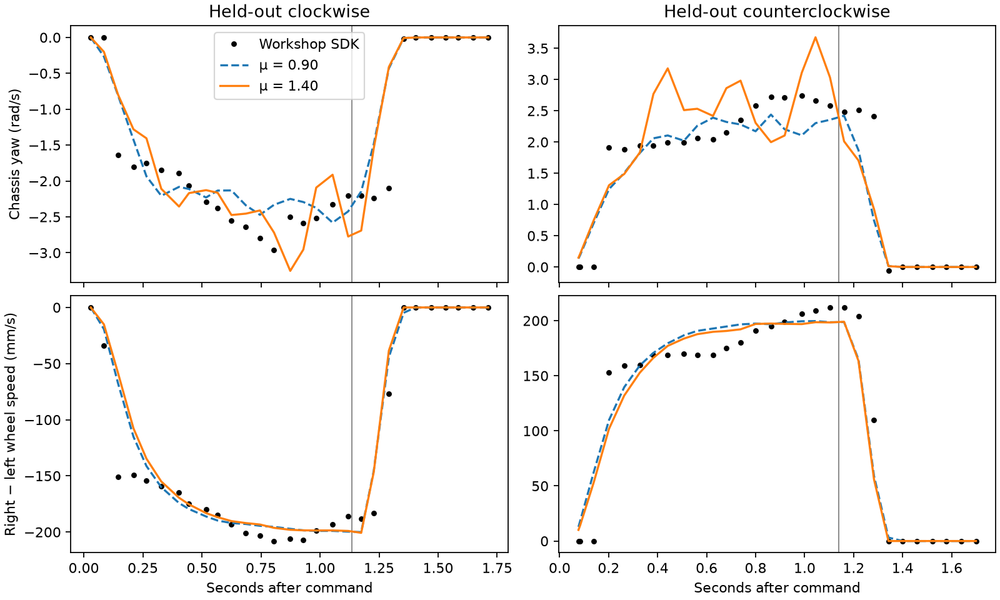

# Does scalar tread friction explain the workshop spin error?

The first CCW and CW turns selected friction from a 0.30–1.50 grid in steps of 0.05 by RMS relative steady yaw error. The repeated CW and CCW turns were reserved for transfer. All four used the same measured starting head and lift readings. The effective inset remained 3.75 mm per end with 48 mm axle spacing. Changing the scalar tread coefficient affects sliding both across and along the tread.

The fit selected 1.40, reducing training RMS error from 11.12% at 0.90 to 2.71%. Neighboring grid points 1.35 and 1.45 scored 12.13% and 10.11%. The isolated minimum and the variation within turns make the selected value a poor physical estimate.

| Held-out turn | Steady yaw error, 0.90 → 1.40 | Measured pitch rate RMS | Modeled pitch rate RMS, 0.90 → 1.40 |
|---|---:|---:|---:|
| CW | −8.17% → −0.16% | 0.102 rad/s | 0.139 → 0.403 rad/s |
| CCW | −8.81% → +8.57% | 0.099 rad/s | 0.115 → 0.355 rad/s |

Steady yaw RMS relative error on the held-out pair falls from 8.50% to 6.06%, still over 5%. Both simulated turns also fluctuate more in yaw than the measured turns at 1.40. Wheel-speed RMSE changes by less than 1 mm/s on either turn. During the first 300 ms after stopping, yaw RMSE changes from 0.818 to 0.843 rad/s CW and 0.802 to 0.787 rad/s CCW. The coefficient fails to transfer across both directions and exaggerates pitch motion. It has not been adopted.

Reproduce with friction_transfer.py using the same prepared reference and PYTHONPATH as compare_spins.py. Here simulated reports are interpolated to the physical SDK receipt times before scoring. The original workshop table averaged native samples on each clock independently. The steady window in both analyses is the last half of the wheel pulse. Tread friction was never measured independently on the workshop tabletop.
