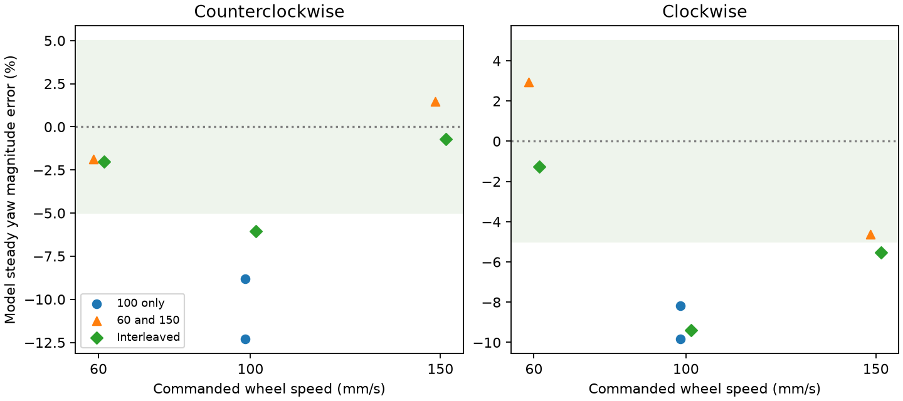
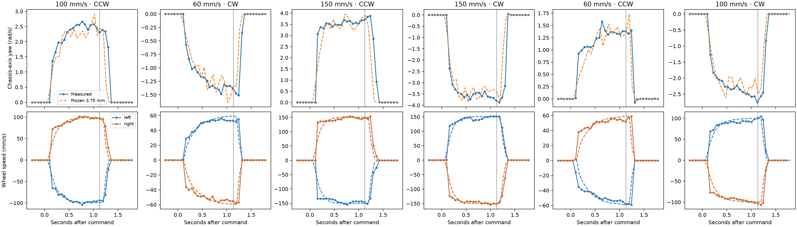

# All three workshop spin speeds in one visit

Six spins in a single undocking tested the frozen 3.75 mm-per-end contact model at three speeds in both directions. The signed right-wheel targets were +100, −60, +150, −150, +60 and −100 mm/s, with the opposite targets on the left. No simulation or estimator parameter was fitted on these turns. Each simulation used the pre-command measured head and lift pose. In the steady windows the physical lift stayed at 30.98 mm and mean head angle stayed between 22.11° and 22.24°.

| Wheel speed | Measured CCW / CW yaw (rad/s) | Model error CCW | Model error CW |
|---|---:|---:|---:|
| 60 mm/s | +1.369 / −1.356 | −2.01% | −1.27% |
| 100 mm/s | +2.511 / −2.461 | −6.03% | −9.39% |
| 150 mm/s | +3.593 / −3.587 | −0.71% | −5.53% |

Both 100 mm/s underpredictions recur when the other two speeds are present in the same session. This is now six underpredictions in six workshop turns at 100 mm/s across two visits. Both 60 mm/s turns meet the 5% steady-yaw target. At 150 mm/s one direction narrowly misses. The table averages predictions at the physical SDK receipt times. The companion scores.csv averages each native sampling grid separately.

The frozen differential-encoder gain from the earlier 100 mm/s fit overpredicts yaw on the new 100 mm/s turns by 1.57–3.18%, and on the 150 mm/s pair by 8.26–8.64%. This points to a speed-dependent conversion between measured wheel speed and yaw in these recordings. One pair per speed in the mixed visit, fixed order, and no independent position or slip measurement leave the underlying mechanism open.

The raw SDK states and event receipts include undock and return. The final battery report confirmed on-platform and charging. For reproduction run the parent compare_spins.py --interleaved using its documented archived model environment, then run sessions.py with NumPy and Matplotlib. The latter also reads states, events and frozen predictions from the two preceding workshop visits.
