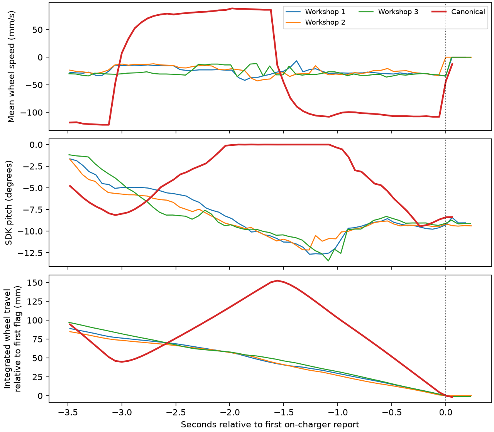

# Charger contact on three workshop returns

The three physical visits ended with a successful native dock return and a battery report confirming charging. We aligned each return at the first SDK state carrying the on-charger bit (4096). The bracket between last off and first on is 64–69 ms. All physical samples come from the original recordings in this directory's parent and its speed-holdout and interleaved subdirectories.

| Return | Median wheel speed in final 720 ms | Pitch at first flag | Time from last −5° pitch crossing | Reverse encoder travel from crossing |
|---|---:|---:|---:|---:|
| Workshop 1 | −30.0 mm/s | −9.28° | 2.78 s | 73.0 mm |
| Workshop 2 | −26.0 mm/s | −9.16° | 3.18 s | 76.8 mm |
| Workshop 3 | −31.5 mm/s | −9.09° | 2.95 s | 80.6 mm |
| Canonical web return | −107.0 mm/s | −8.40° | 0.57 s | 59.5 mm |

The web trace uses the first-generation default web MuJoCo scene, a native simulated undock followed by the simulated dock imperative, and seed 1. It is a comparable mount from a different initial approach. The successful simulated approach is much faster, and it reaches the flag with less encoder travel after the same pitch landmark. The traced wheel travel is trapezoidal integration of mean reported left and right wheel speeds on the host receipt clock. The −5° crossing is linearly interpolated. These recordings have no independent camera measurement of ramp travel or electrical-contact depth.

## Testing a slower backup

Setting all five backup speed targets to −30 mm/s in an isolated copy produced zero contact flags and a timeout after 70 s (one counted mount attempt). Doubling the behavior deadline to 140 s gave two counted attempts and again zero flags. This rejects the speed-only replacement for this start and seed. Ramp contact mechanics, alignment and retry behavior remain possible contributors. Failed mounts have no first-on edge to plot. The default simulator was left unchanged.

With the web dependencies installed, run node replay.mjs, bash candidate.sh, bash candidate.sh 140, and python score.py. The two slower traces are candidate.csv and extended.csv. Simulated states are recorded once per publication. The time of the reported flag has one publication interval of uncertainty.
