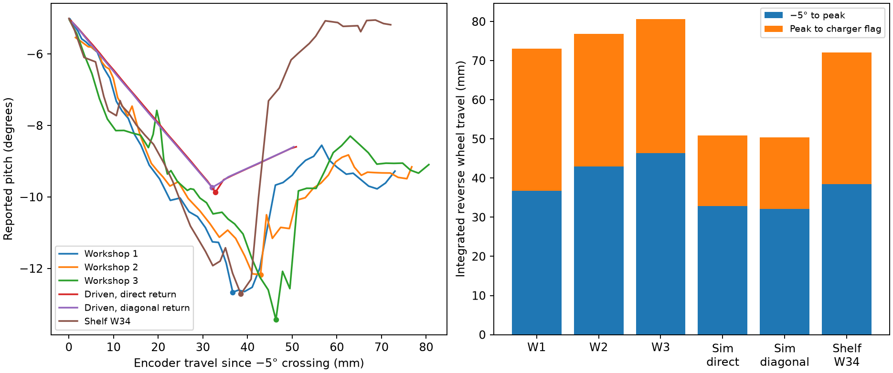

# Where the stock-speed dock replay loses travel

In each recorded return we integrate the signed mean of the two reported wheel speeds over actual packet intervals, starting at the last downward crossing of −5° before the first on-charger packet. We split this travel at the most nose-down pitch between the crossing and contact. This uses chassis attitude landmarks that can be identified without the SDK pose reset at contact.

| Source | Travel before peak | Travel after peak | Peak pitch | Peak to flag |
|---|---:|---:|---:|---:|
| Workshop, three returns | 36.7–46.4 mm | 33.9–36.3 mm | −12.2° to −13.4° | 1.09–1.27 s |
| Driven rear rollers, two simulated returns | 32.1–32.8 mm | 18.1–18.3 mm | −9.7° to −9.9° | 0.60 s |
| Shelf W34, a different robot and setup | 38.5 mm | 33.5 mm | −12.7° | 1.04 s |

The largest shortfall appears **after peak pitch** in all three workshop returns compared with either simulated approach. The simulated climb is also shallower at its peak. A charger flag delay alone cannot account for that earlier attitude error. Using a centered five-packet moving average to locate the peak leaves the separation between measured and simulated post-peak travel intact. During the workshop peak-to-flag interval the head encoder reported zero net angle change; the integrated head gyro Y recorded 2.8–4.0° in magnitude.

On shelf W34 the camera provides an independent check over the final 2.42 s between measured images before contact. At the actual frame times, the axle midpoint moved approximately 67.9 mm horizontally against 71.9 mm of integrated wheel travel. We used the existing side-view scale (48 mm divided by median horizontal hub spacing). Perspective and chassis rotation affect that estimate. The frame interval spans the peak, so its camera measurements cannot independently locate the peak or partition the travel on either side. W34's first-on pitch differs from the workshop readings. These are distinct setups.

The next physical-model comparison should score peak pitch and post-peak distance separately. These observations alone cannot distinguish dock surface shape, chassis support, sensor dynamics, slip or the electrical contact condition. No simulator parameter was fitted here.

Run python climb.py with NumPy and Matplotlib from this directory. The two simulated completions are from the driven rear support experiment. The physical samples are from the workshop experiment and the archived W34 return.
