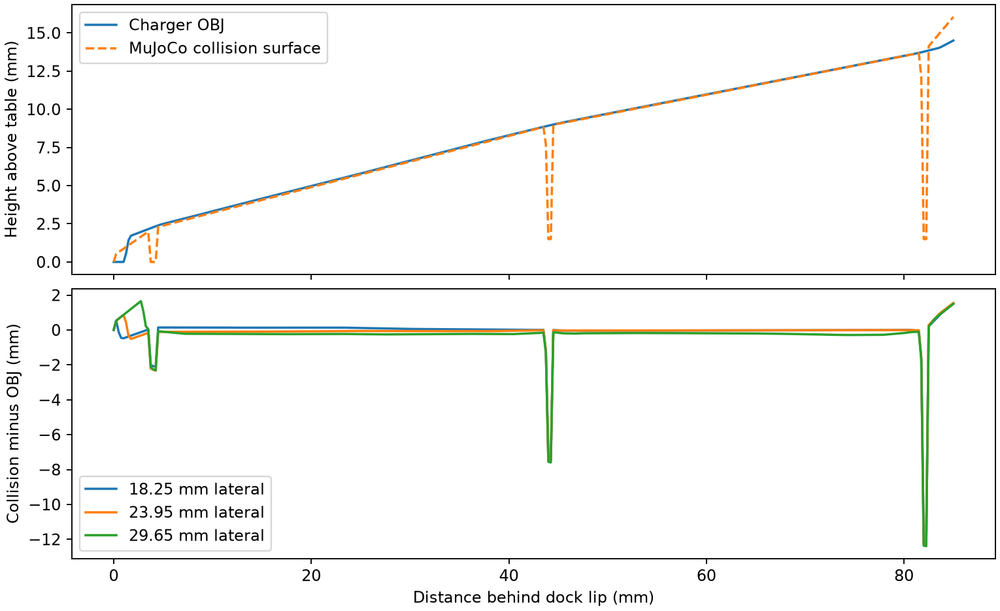

# How closely does the collision ramp follow the charger mesh?

At the center of a tread, a vertical line at 44.25 mm behind the dock lip finds the simulated collision surface 7.47 mm below the charger OBJ. The adjacent boxes almost meet at this point. A modeled 10.45 mm-radius rear roller spans the seam: across stations 5–75 mm the maximum difference in its supported center height is **0.107 mm**. The 14.5 mm-radius front wheel differs by at most 0.105 mm along the same section. These bounds apply to that straight vertical section, before the rear pocket. They do not measure a physical charger.

The plot samples every 0.25 mm along the dock at six lateral positions (±18.25, ±23.95 and ±29.65 mm). The visual mesh uses the web renderer's Maya-to-charger transform and the high-poly OBJ checksum pinned by the repository. We intersect vertical rays with triangles from the mesh and oriented box faces; the table is the fallback surface. For the circular wheel envelope we take the maximum of surface height plus the circle's vertical offset at every reachable station. This accounts for a rigid wheel contacting the shoulder of a seam.

## Paired simulation test

We extended the lip, apron, bed and pocket boxes by 0.65 mm at each longitudinal end, preserving their slopes and center heights. This is a sensitivity test on the experimental driven rear rollers at stock backing speed. It is not a calibration of dock dimensions.

| Result | Original collision boxes | Extended boxes |
|---|---:|---:|
| Successful straight approaches | 3/5 | 3/5, same poses |
| Successful autonomous returns | 2/3 | 2/3, same starts |
| Direct return peak nose-down pitch | 9.87° | 9.77° |
| Direct return, peak to charger flag | 18.08 mm | 17.99 mm |
| Negative diagonal, peak to charger flag | 18.27 mm | 18.38 mm |

The seam changes neither measured discrepancy materially. The three workshop recordings gave 12.2–13.4° peak nose-down and 33.9–36.3 mm of wheel travel after the peak. This comparison leaves the pocket, lateral alignment, tread slip, and contact detection as distinct questions. The canonical simulator has not been edited.

For reproduction fetch the pinned visual assets with the repository's web/tools/fetch_dock_model.py. Run python dock_profile.py, node seam-bench.mjs, bash seam-returns.sh and python seam_score.py here with the web dependencies, NumPy and Matplotlib. The CSVs include all six sections, five paired straight approaches and the successful and failed autonomous starts.
