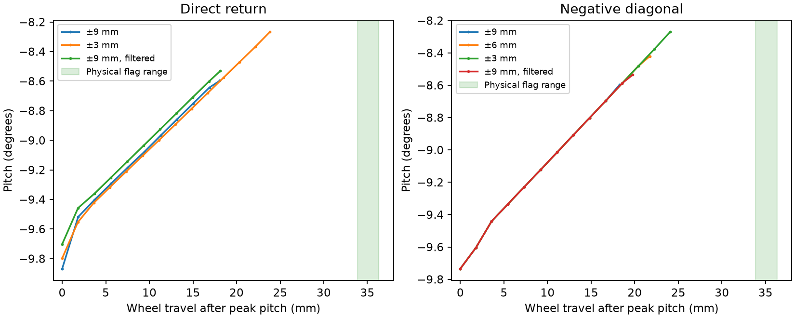

# Can the charger contact window explain the missing wheel travel?

The web model tests both charger pins against the robot pads. We varied only the allowed longitudinal offset per pin, holding the lateral and height checks fixed. Each variant uses the same driven rear rollers, −30 mm/s backup, and three starts from the previous dock study. The direct start includes undocking, which can itself change when the contact rule changes. The two diagonal starts are independent of undock. A fourth run starts in the simulator's default seated pose and samples the flag over three seconds.

| Longitudinal tolerance | Direct peak-to-flag | Negative diagonal | Positive diagonal | Default seated samples on |
|---|---:|---:|---|---:|
| ±9 mm | 18.08 mm | 18.27 mm | Timeout | 51/51 |
| ±6 mm | Timeout | 21.72 mm | Timeout | 51/51 |
| ±3 mm | 23.82 mm | 24.06 mm | Timeout | 0/51 |
| ±9 mm with stock debounce | 18.14 mm | 19.75 mm | Timeout | 51/51 |

Three physical workshop returns gave 33.86–36.32 mm from peak nose-down pitch to the first on flag. On the negative diagonal, narrowing the tolerance by 6 mm moved the first reported chassis origin 5.61 mm deeper relative to the dock lip and added 5.79 mm of integrated wheel travel. Even this narrowest trial fell 9.80 mm short of the smallest workshop value and lost contact detection in the default seated pose. The comparison covers voltage-on status. Battery charging current is a separate signal.

## Firmware timing

The physical HAL reads the system controller's POWER_ON_CHARGER bit for contact voltage. In the stock controller a change of sampled external voltage resets the debounce counter. Five successive same-state ticks increment it and the following same-state tick changes the flag. At 200 Hz a sustained change takes 30 ms from its first changed sample, plus sampling phase relative to the physical transition. This filter is applied on both edges. The isolated simulator variant reproduces that state machine using geometric contact as a proxy for voltage. The default seated initialization predates the trial filter. No voltage waveform was recorded in these sessions. [HAL flag](https://github.com/os-vector/wire-os-victor/blob/3cec4844d24c4719b5b3892e4979494bcd260424/robot/hal/src/hal.cpp#L1142-L1147) · [Tick rate and threshold](https://github.com/os-vector/wire-os-victor/blob/3cec4844d24c4719b5b3892e4979494bcd260424/robot/syscon/src/analog.cpp#L23-L30) · [Filter and caller](https://github.com/os-vector/wire-os-victor/blob/3cec4844d24c4719b5b3892e4979494bcd260424/robot/syscon/src/analog.cpp#L416-L446)

The filter removed short post-return flag dropouts in these two simulated successes (50/50 on samples for both, compared with 48/50 and 50/50 in the instantaneous runs). It adds at most 1.49 mm to the two peak-to-flag wheel distances here. Neither intervention recovers the physical travel. A physical electrical measurement or camera-calibrated pad depth would distinguish sensor geometry from chassis motion. No canonical runtime parameter was changed.

Run bash pad-window.sh separately for widths 9, 6 and 3, then bash pad-window.sh 9 filtered, followed by python pad_score.py. The CSVs use simulator state publications; depth_mm is the physical simulation origin behind the dock lip before SDK localization offsets. The status counts in pad-summary.csv cover the resting interval. A timeout's subsequent rest samples are taken wherever the drive stopped.
