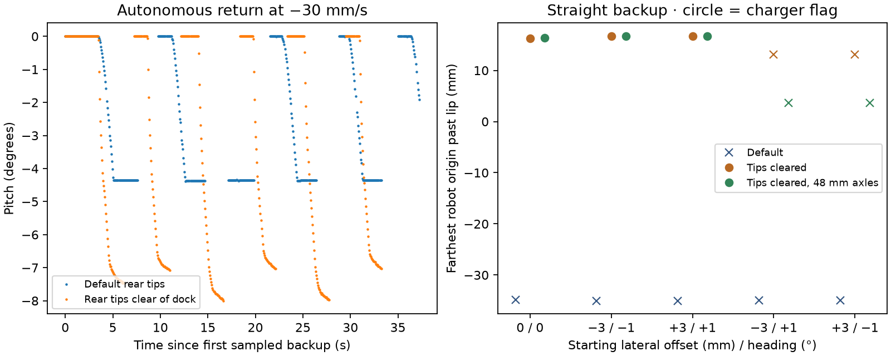

# What prevents a stock-speed climb?

The stock-speed dock return in the preceding experiment never reached the −5° pitch landmark seen on all three physical returns. At each web state publication during backup we grouped MuJoCo elliptic normal constraint forces by geometry pair. The two chassis-fixed rear tip cylinders contacted the dock lip and apron. Neither rear wheel registered a dock contact in those samples. The tip cylinders have high sliding friction and cannot rotate relative to the chassis.

In a paired run we changed the rear tips' collision masks when backup began, preserving their table and floor contacts and allowing the wheels to meet the dock. Maximum nose-down pitch rose from 4.38° to 8.00°. Maximum rearward travel increased by 26.4 mm in table X. The left rear wheel registered contacts with the right dock funnel and the robot still timed out. The trace covers sampled backup stages, with gaps possible between stages. The contact forces are instantaneous solver values, not measured hardware forces.

## Controlled approach at 30 mm/s

Each of five starts used the same 100 mm forward clearance from the modeled lip, 45 mm lift, level surface, and straight reverse wheel commands for up to eight seconds. The centered start and four combinations of ±3 mm lateral offset and ±1° heading test sensitivity to initial alignment.

| Collision geometry | Electrical contacts | Maximum nose-down pitch across starts |
|---|---:|---:|
| Canonical default | 0/5 | 4.36–4.38° |
| Rear tip proxies clear of dock | 3/5 | 8.23–9.75° |
| Same clearance, wheel axes moved to 48 mm spacing | 3/5 | 9.40–10.07° |

The centered approach and the two same-sign offsets seated with both diagnostic geometries. The opposite-sign offsets missed on each side. Removing this artificial sliding contact explains the early stall for the tested starts. Correcting alignment and preserving physical support for tipping still matter. Suppressing collisions is a diagnostic and has not been shipped to the simulator. These runs reuse earlier physical reference measurements.

Run bash load-test.sh, node bench.mjs, then python ramp_plot.py with web dependencies, NumPy and Matplotlib installed. The two load CSVs contain per-pair summed normal force in newtons for the slow autonomous return.
