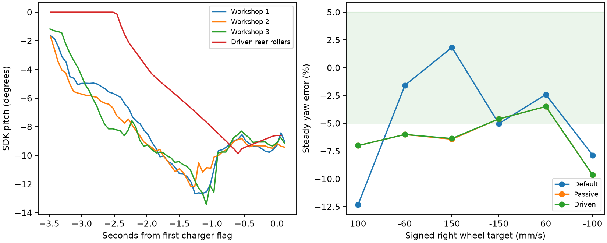

# Rotating rear support at stock docking speed

The driven rear rollers seated on the first counted mount attempt after an undock and native simulated return at a −30 mm/s backup target. In the final 720 ms before the charger flag, median wheel speed was −31 mm/s (three physical returns: −26 to −31.5). The first-on pitch was −8.60° (physical: −9.09° to −9.28°). This compares reported motion and contact; each run has its own starting approach. The earlier default geometry timed out with the same slow backup settings.

Two 0.05 g experimental cylinders retain the original rear support shapes, positions, radii and contact properties. Each hinge turns about the transverse axis. In the driven version a joint constraint gives the roller the same tangential speed as the front wheel on its side. A welded version controls for reparenting the geometry and adding mass. A passive version spins freely. No contact surfaces are masked.

| Variant | Direct straight mounts | Native slow return immediately after undock | Torque to pitch 10° in either direction |
|---|---:|---|---|
| Default rigid tips | 0/5 | Timed out | 37.45 / 61.75 mN·m |
| Welded cylinders | 0/5 | Untested | 37.45 / 61.80 mN·m |
| Free rollers | 3/5 | Timed out | 37.45 / 61.80 mN·m |
| Driven rollers | 3/5 | Seated | 37.45 / 61.80 mN·m |

The five straight starts span the center and ±3 mm / ±1° combinations. The welded control climbed farther than the original fixed tips despite failing to seat, so the difference in climb depth cannot be attributed solely to rotation. The torque comparison is a simulation regression on a level table with a 22° head, 32 mm lift, stopped motors and a progressively applied world-Y moment. It checks support in that posture; it does not calibrate physical tipping force.

Two additional native returns started at (100, ±60) mm with headings ±45°. The driven candidate seated from the negative lateral offset. The positive offset timed out. On six previously recorded workshop spins, the driven candidate had 6.49% RMS steady yaw error against the physical gyro; the default had 6.47%. Individual errors shifted by several percentage points and the 5% target was missed. Docking and tipping results are insufficient to promote this geometry to the canonical runtime.

Run node roller-bench.mjs, node roller-pitch.mjs, node roller-spins.mjs, bash roller-returns.sh and python roller-score.py from this directory with the web dependencies installed. The scripts build the variants in memory or in a temporary sibling of the simulator source. The CSVs give individual poses, spins, torque thresholds and return traces.
