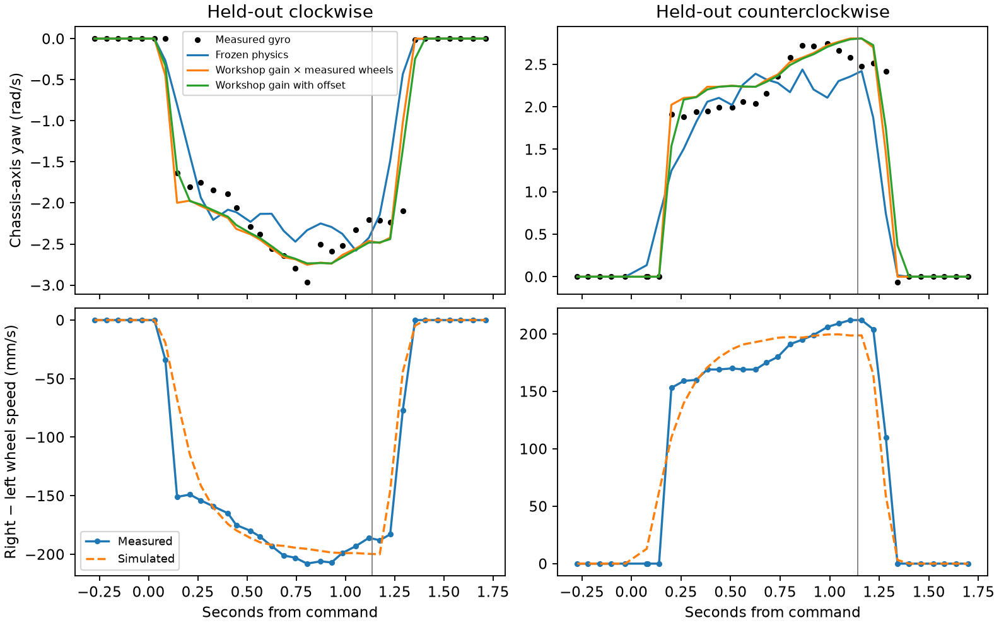
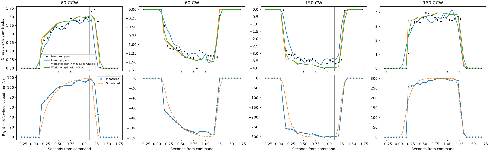

# Workshop spin transfer across speeds

A second physical visit to the third hard surface added four 1.1-second pulses and 932 SDK samples. The robot ran +60, −60, −150 and +150 mm/s (signed right-wheel targets with opposite left-wheel targets), then returned to the dock and charged. The first session supplied two 100 mm/s calibration turns and two separate same-speed validation turns. This second session and its speeds were entirely held out.

The estimator predicts chassis-axis yaw from differential reported wheel speed. Fitting the means of the first two steady windows with zero intercept gives 0.01323065 (rad/s)/(mm/s). The corresponding gain from the frozen 3.75 mm simulator is 0.01182999. On the two reserved 100 mm/s turns, physical gain × measured wheel speed overpredicts steady yaw by 2.96% and 1.80%. Model gain × measured wheel speed remains 7.94% and 8.97% low. The gain is an empirical input/output relationship distinct from either axle spacing or contact inset.

| New pulse | Physical mean yaw (rad/s) | Frozen physics error | 100 mm/s gain × measured wheels error |
|---|---:|---:|---:|
| 60 CCW | +1.365 | −1.87% | +5.43% |
| 60 CW | −1.321 | +2.95% | +7.40% |
| 150 CW | −3.657 | −4.63% | +6.74% |
| 150 CCW | +3.602 | +1.45% | +8.24% |

Here errors compare mean yaw magnitude over the last half of each command after interpolation to physical packet times. The 100 mm/s gain overpredicts yaw on every new turn. Frozen physics meets a 5% **steady mean yaw** tolerance in each new case. With one pair per speed and different sessions for 100 versus 60/150 mm/s, the runs cannot distinguish a speed-specific effect from session differences.

The transient diagnostic searches −120 through +120 ms in 5 ms increments on the first two 100 mm/s turns. A +15 ms apparent delay minimized the combined spin-up and braking yaw squared error. With the gain and delay frozen, braking RMSE at the new speeds ranges from 0.215 to 0.527 rad/s, compared with 0.226–1.079 for frozen physics. All four braking errors decrease, with the smallest improvement on the 60 CW stop. The offset includes sample timing, interpolation and mechanical dynamics. These approximately 60 ms SDK samples cannot resolve a 15 ms sensor latency independently. Predictions using real wheel speeds also have access to measurements unavailable to a command-only simulator.

The free model and its contact parameters remain frozen. There is no independent position trace for these runs. From the parent evidence directory, run compare_spins.py --fresh with the archived reference environment documented there. Run encoder_transfer.py with no arguments and then with --fresh to reproduce the calibration, original holdout and new-speed overlays. capture.py is the paired-pod physical recorder; replay and scoring are offline.
