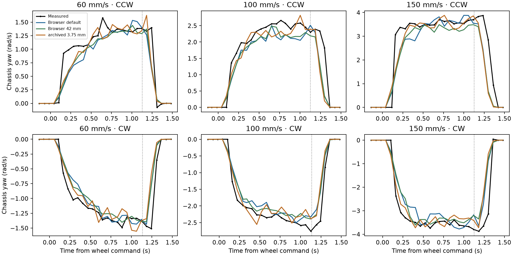

# Workshop spins in the canonical web simulator

Fourteen recorded stock-tread spins from three workshop visits were replayed at the commanded wheel speeds and durations with each measured starting head and lift pose. The simulator ran headlessly through the same VectorSim implementation and MuJoCo WASM used by the web interface, at repository revision ffca93b3223d28cba5e403e6cfe68fe289c462aa. Both first-generation scenes include the free cube and dock. The robot starts off the dock. The 42 mm scene is the existing optional contact model.

The dotted line marks the stop command. We project the head gyro onto chassis yaw, interpolate each prediction at the physical SDK packet times, and average the second half of each commanded spin. The table gives root mean square percentage error across individual steady turns at each speed. The CSV also gives the first 300 ms of braking error in rad/s for each trial.

| Wheel speed | Physical turns | Web default | Web 42 mm | Archived 3.75 mm inset |
|---|---:|---:|---:|---:|
| 60 mm/s | 4 | 4.35% | 4.24% | 2.11% |
| 100 mm/s | 6 | 12.15% | 12.25% | 9.27% |
| 150 mm/s | 4 | 3.90% | 6.34% | 3.69% |

The web default underpredicts yaw magnitude by 7.9–15.1% on all six 100 mm/s turns, across both directions and two visits. Changing scenes does not resolve it. These command-driven replays include motor response as well as contact dynamics. They cannot isolate the cause or establish physical drift without an independent position trace. All parameters were frozen.

To reproduce, install the repository web dependencies, run prepare.py, run node replay.mjs, then run score.py with NumPy and Matplotlib. browser.csv contains the simulated state publications. Physical states, command events and archived model predictions are in the parent directory and its speed-holdout and interleaved subdirectories.

As a deployment cross-check, substituting the default XML served by Hugging Face Space revision 292c4943c3172d085b3318f60ba8b94e183d2d51 in the repository runtime reproduced all 479 default-scene rows exactly. This checks the deployed asset under the same runtime. The hosted JavaScript bundle was not executed in this comparison.
