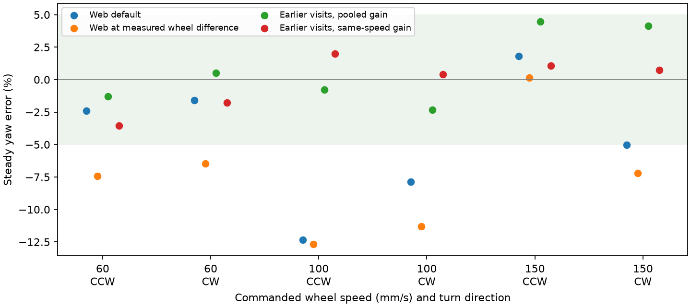

# Wheel-speed and chassis-yaw transfer

The complete interleaved workshop visit is held out for this calculation. All predictions use signed steady-window means at physical SDK receipt times. Wheel difference is right minus left. The first diagnostic multiplies default web yaw by measured wheel difference divided by web wheel difference. This factors out a proportional motor-speed error within each turn. It is an algebraic check rather than a closed-loop dynamics replay.

| Predictor | Held-out steady yaw RMS error | 100 mm/s CCW / CW error |
|---|---:|---:|
| Canonical web default | 6.47% | −12.32% / −7.88% |
| Web yaw scaled to measured wheel difference | 8.54% | −12.68% / −11.30% |
| Measured wheel difference × pooled workshop gain | 2.74% | −0.77% / −2.31% |
| Measured wheel difference × same-speed workshop gain | 1.89% | +1.98% / +0.39% |

Each empirical gain is the unweighted mean of the earlier turns’ measured yaw divided by measured wheel difference. The pooled estimate uses eight turns. The same-speed estimate uses two turns at 60, four at 100, and two at 150 mm/s. Both predictors require measured wheel speeds from the test run. The six interleaved trials were previously examined for model discrepancies, so a prospective test is still needed to establish the advantage of speed-specific gains.

At 150 mm/s we transferred the same workshop gain to the published steady windows on two other surfaces. It overpredicted both unit 1 spins (+5.49%, +6.42%) and all four unit 3 spins (+2.25% to +3.53%). The physical robot and surface change together. These comparisons cannot assign the difference to surface friction alone. A universal correction would miss the 5% target on both unit 1 trials. No contact parameter or runtime gyro output was changed.

Run wheel_transfer.py with NumPy and Matplotlib. wheel-transfer.csv contains the six within-workshop comparisons and wheel-transfer-other-surfaces.csv contains the cross-unit predictions.
