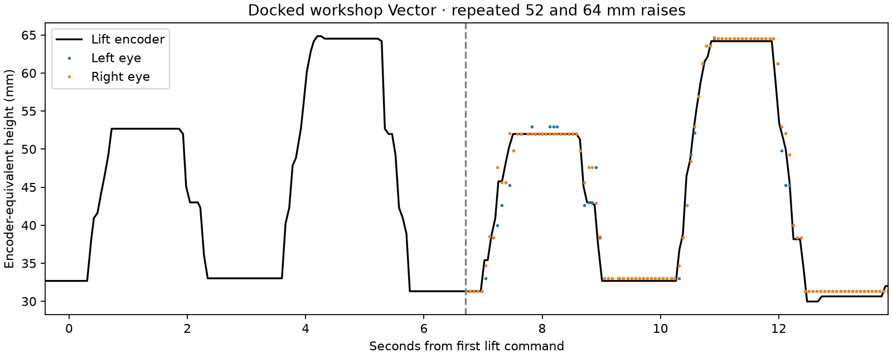

# Docked lift observed by a workshop stereo camera

One workshop robot repeated 52 → 32 → 64 → 32 mm twice from its charger. Each SDK lift request specified 0.65 s. Both ZED 2 eyes saw the commanded sequence. All 258 SDK packets asserted dock contact. The wheels were commanded zero times. One left-wheel report was −1 mm/s, all others were zero. The platform flag was still true after lowering the lift, at 3.549 V.

[Rectified stereo clip](lift.mp4) · [Relative frame timestamps](camera.csv) · [SDK samples and command acknowledgments](sdk.csv)

The capture contains 624 stereo pairs at 2560 × 720. The published clip contains 216 robot-cropped pairs covering the motions at approximately 15 Hz. Factory HD calibration and the existing five-coefficient distortion model rectify both eyes. Frame and SDK times are host receipt times on two NTP-synchronized machines. Exposure-to-SDK timing uncertainty was not independently measured.

For each eye we used a narrow strip containing an outer fork post. The first four moves provide image templates labeled by interpolated physical encoder height. On the repeated four moves we predict height by nearest mean absolute grayscale difference. Mean absolute errors across 108 reserved frames were 0.92 mm (left) and 0.81 mm (right). Restricting to the 43 reserved frames where the magnitude of the encoder slope exceeds 5 mm/s gives 1.70 and 1.51 mm. Repeatability on this run supports using the camera to score future lift motion. These are encoder-equivalent measurements from two distinct fork features. They do not establish an absolute stereo height or simulator accuracy.

Run python score.py here with NumPy, OpenCV and Matplotlib to regenerate the overlay and [frame estimates](eye-estimates.csv).
