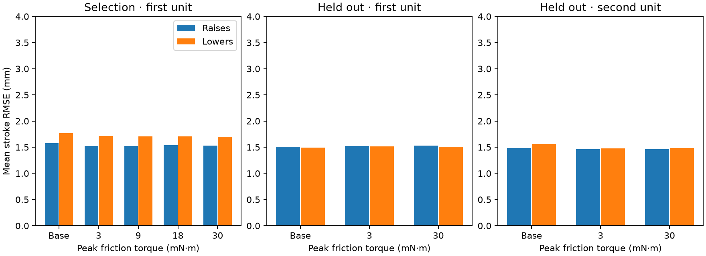

# Does higher friction near zero lift speed reproduce the pause?

We selected a speed-dependent friction curve on six physical 52 mm lowers, then froze it for two recordings of eight 48/56 mm lowers each. The selected candidate missed every observed pause in the held-out recordings (two on the first robot, six on the second). Its only predicted pause on each robot occurred on the first lower, which had no qualifying physical pause.

| Mean lowering height RMSE | Canonical | Constant 3 mN·m | 30 mN·m at rest, 3 mN·m sliding |
|---|---:|---:|---:|
| First robot, six selection lowers | 1.769 mm | 1.711 mm | 1.696 mm |
| First robot, eight held-out lowers | 1.493 mm | 1.514 mm | 1.506 mm |
| Second robot, eight held-out lowers | 1.565 mm | 1.481 mm | 1.483 mm |

The frozen candidate also changed mean raising RMSE from 1.505 to 1.531 mm on the first held-out robot and from 1.489 to 1.465 mm on the second. The comparison keeps the canonical robot as the default. Constant sliding resistance accounts for essentially all the improvement on the second unit. The added near-zero resistance did not consistently improve transfer.

At each simulator tick the diagnostic sets hinge friction loss to sliding torque plus the excess at rest times exp(−(hinge speed / 0.1 rad/s)²). Peak torques were 9, 18 and 30 mN·m; the common sliding torque was 3 mN·m. This is a sensitivity test of one smooth speed-dependent friction law. The speed scale and torques are assumptions. It has no stored gear preload or backlash state. Actual fork torque was not measured.

We minimized mean stroke RMSE on the six selection lowers (1.709, 1.705 and 1.696 mm for the three peak settings), then evaluated the selected peak, constant control and canonical model on the held-out commands. RMSE spans up to 1.4 s after each command, capped at the next command or end of the recording. All replays maintained dock contact at every published sample. SDK packet times and the [frozen target-crossover pause rule](../target-crossover/README.md) were applied to physical and simulated traces. The held-out data were available from prior analysis but were excluded from parameter selection.

[Per-command scores](scores.csv) · [Second-generation physical comparison](../target-transfer/README.md). Run python run.py with NumPy, Node and the canonical web dependencies, then python plot.py with Matplotlib.
