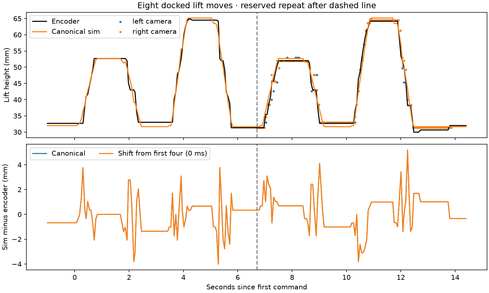

# Canonical replay of the workshop stereo lift sequence

The simulator received only the eight time-stamped target heights, the requested 0.65 s duration, and the initial measured head and lift posture. We used the canonical first-generation dock scene and the existing workshop duration replay. The recorded gearbox, dock, and posture history before this test are unknown.

On the four reserved moves the mean absolute height error across 39 moving SDK packets was **1.77 mm**. Moving packets have an absolute encoder slope above 5 mm/s. A single timing shift selected on the first four moves over −200 to +200 ms in 5 ms steps selected **zero**. On all 108 held-out camera frames, mean absolute simulator versus optical differences were **1.31 mm left and 1.16 mm right**. Both optical estimates use first-half encoder heights for their calibration, and are observations of the same motions.

The simulator finished each action in 0.850 s. The physical SDK call returned after 0.922–1.220 s. Adding the median first-half return difference (125 ms) to completion time reduced held-out mean absolute return error from 176 to 77 ms. The final 64→32 mm lower still returned 245 ms later than that corrected prediction. It also settled at 30.65 mm, compared with 32.68 mm on the earlier held-out 52→32 mm lower. The simulated endpoint was 31.66 mm both times. A uniform delay would conflate motion timing, settling and host-observed action return. We retained the frozen model.

[Per-move measurements](move-errors.csv) · [SDK recording and video](README.md). Run python run.py with the canonical web dependencies, then python replay_score.py with NumPy and Matplotlib.
