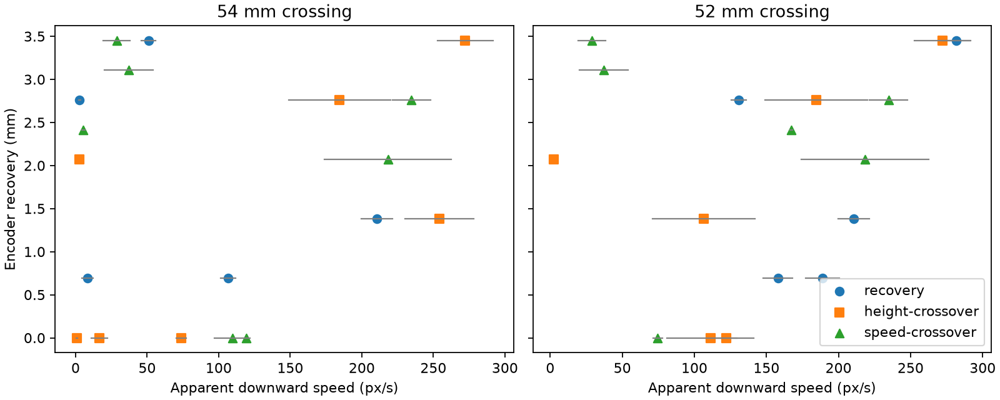

# Fork speed near the target on the docked workshop Vector

A fresh 7.60 s docked recording supplies 115 stereo pairs with the camera and robot in their workshop positions. The fixed tread landmarks moved at most 0.081 px in the left image and 0.113 px in the right image relative to frame one. The lowest match correlation was 0.923. This bounds apparent motion for these stationary landmarks during this clip. Motion blur, changing fork appearance, and synchronization contribute additional error on moving trials.

[Fresh rectified stereo clip](rest.mp4) · [Frame times](rest-camera.csv) · [Static control measurements](rest-control.csv)

Across 22 earlier physical lowers, we interpolated the first downward encoder crossing at 54 and 52 mm. At each crossing we tracked the fork in the two camera frames bracketing that timestamp. Median frame spacing was 67 ms. Each eye uses its own settled fork-post template. We reject matches at the search boundary or below 0.85 normalized correlation. Gray segments in the figure span the estimates from the two eyes. They show optical disagreement and exclude timing uncertainty.

All 22 moves crossed 54 mm. Both eyes yielded speeds in 19. Only 17 crossed the commanded 52 mm before the first in-position flag, and both eyes yielded speeds for all 17. Median absolute left/right disagreement was 12 px/s at 54 mm and 22 px/s at 52 mm.

In the eight-move duration crossover at 54 mm, the five moves with upward recovery had mean-of-eyes speeds ranging from 5 to 235 px/s. Two moves with zero recovery measured 109 and 119 px/s. The third zero-recovery move lacked a valid left-eye match. At 52 mm the five reversals ranged from 29 to 235 px/s and the single measurable zero-recovery move was 75 px/s. The speed ranges overlap at both planes. These measurements do not support a single increasing speed threshold to add to the canonical controller.

The 54 and 52 mm crossings sometimes fall in the same camera interval. The ZED and SDK supply host receipt timestamps, so frame selection can change with timing offset. Pixel speeds measure projected motion. The next discriminator would be synchronized lift-motor effort and encoder motion through the final approach and reversal.

[Per-move data including missing measurements](crossings.csv) · [Duration crossover and canonical replay](../speed-crossover/README.md). Run crossing.py and rest.py in this directory with NumPy, OpenCV and Matplotlib. crop_rest.py reproduces the stereo crop on the capture host from raw frames.
