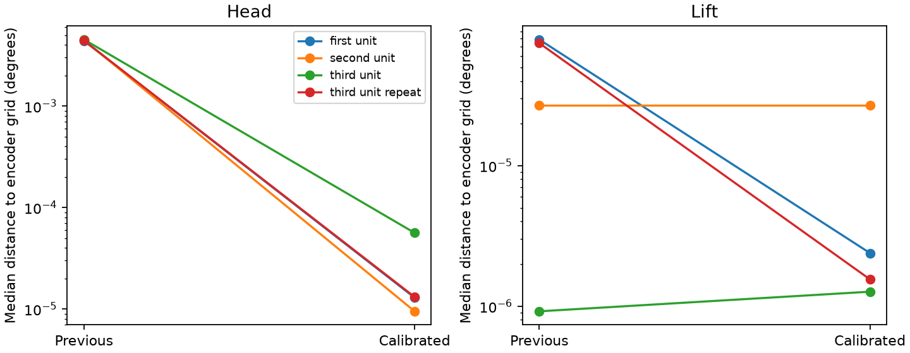

# Calibrated head and lift encoder readings

The physical head controller resets the shaft count at its calibrated lower limit. The browser and Python implementations now report the nearest encoder count measured from that angle (−22° on both current models). Both joint scales use the firmware HAL expressions rounded to its float32 storage precision. The existing lift origin is already the calibrated low angle. [Head reset](https://github.com/kercre123/victor/blob/669ec7499a7084640b57706a7937884a6568be50/robot/supervisor/src/headController.cpp#L190-L195) · [HAL scales](https://github.com/kercre123/victor/blob/669ec7499a7084640b57706a7937884a6568be50/robot/hal/src/hal_motors.cpp#L61-L66)

Four physical recordings from three units supply 2,266 SDK packets. Session median head residuals fell from 0.00440–0.00453° to 0.0000095–0.0000563°. The largest individual corrected head residual was under 0.000070°. Lift median residuals were already below 0.000080° in all four sessions. The updated scale reduced the residual in the two recent recordings; one older session was unchanged and the third unit's older session increased by about 0.00000035°.

For each reported joint angle we measure absolute distance to the nearest possible reading under each simulator mapping. Lift height is converted to shoulder angle using the model linkage. The firmware defines the origin and spacing independently of these samples. Absolute calibration accuracy against an external instrument and the timing of physical motion require separate tests.

[Per-session measurements](scores.csv). Run score.py then plot.py in this directory to regenerate the comparison from the archived SDK states.
