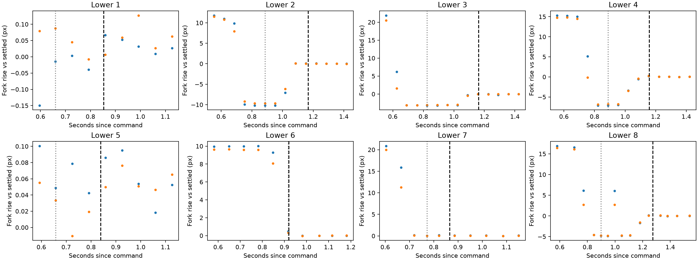

# Does a higher preceding raise cause more recovery on the next lower?

We deliberately alternated preparation targets of 62.5 and 65 mm before eight physical lowers to the same 52 mm target, using 0.6 s for both directions. The four adjacent pairs used low/high, high/low, high/low, low/high order. The first preparation began at the lowered rest position; later preparations began after a 52 mm command. The existing stereo tracker and in-position scoring rules were reused.

The higher preparation raised the measured starting position in every pair (mean difference 2.41 mm). The higher group reversed on three of four lowers and the lower group on one of four. The paired mean difference was **+162 ms to first in-position and +1.03 mm of encoder recovery**. Both camera views agreed on the direction of the physical differences when the encoder detected a reversal.

| Pair | Higher minus lower starting height (mm) | First in-position difference (ms) | Recovery difference (mm) |
|---|---:|---:|---:|
| 1 | +2.67 | +313 | +3.45 |
| 2 | +0.99 | +5 | −1.38 |
| 3 | +2.65 | −81 | 0.00 |
| 4 | +3.31 | +409 | +2.07 |

Pair 2 reversed more after the lower preparation. Pair 3 showed no reversal after either preparation, including the physical start at 65.17 mm. This small within-robot experiment supports a possible starting-height effect, with substantial variation at both targets. Changing the starting height also changes stroke length and motion profile at fixed duration.

The [canonical replay](sim.csv) predicted zero recovery on all eight lowers, including four with an optically confirmed physical reversal. A deterministic threshold on preparation height would also misclassify trials. All 529 SDK states reported dock contact; the lift was lowered and dock presence verified afterward.

[Rectified video](lift.mp4) · [Paired measurements](crossover.csv) · [Correlation and control patches](summary.csv) · [Earlier observational prediction](../prelower.md). From this directory run python crossover.py and python sim.py with the existing analysis and web simulation dependencies.
