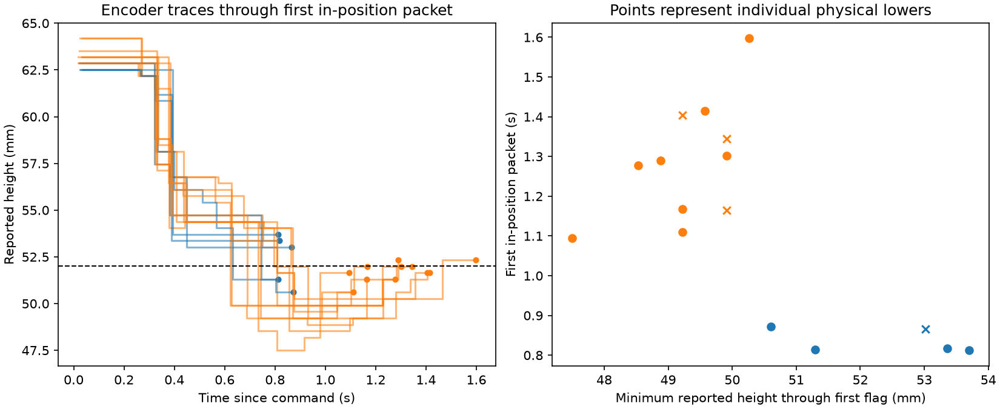

# What happens before a delayed 64→52 mm lower completes?

Sixteen docked commands across two sessions requested the same 0.6 s lower. Eleven took more than one second to report in position. Every one of those eleven passed below the target to 47.50–50.26 mm and then **rose 1.38–4.14 mm** from its minimum by the first in-position packet. The five faster moves reported in position at 0.812–0.872 s, at their minimum observed height. The delayed packets arrived at 1.095–1.597 s. The one-second grouping describes these recordings.

The canonical replay bottomed at 51.64 mm on all sixteen moves and first reported in position at 0.853–0.875 s on the physical packet grid. Its trajectories miss the deeper descent and recovery. These data describe the reported height; they cannot distinguish drivetrain play, friction, quantization or a controller correction without additional measurements.

## How much can early encoder data predict?

Using only the first 600 ms of encoder reports, we matched each move to the most similar move from the other session and predicted its first in-position time. Features are 50 ms grid samples from 200 ms onward, each using the latest preceding encoder reading. Similarity is mean absolute height difference. All forecast cutoffs precede the earliest observed flag. The comparison baseline predicts the training session's median flag time.

| Test session | Lowers | Median baseline MAE | Early trace MAE |
|---|---:|---:|---:|
| Status recording | 4 | 192 ms | 117 ms |
| Approach-history recording | 12 | 225 ms | 166 ms |

Using the first 800 ms gave 118 and 166 ms respectively. The predictions require partial physical telemetry; the minimum and recovery values in the first paragraph are retrospective. The two sessions are from one robot.

[Per-move results](lower-shape.csv) · [Completion timing across four sessions](timing-transfer.md). Run python lower_shape.py here with NumPy and Matplotlib.
