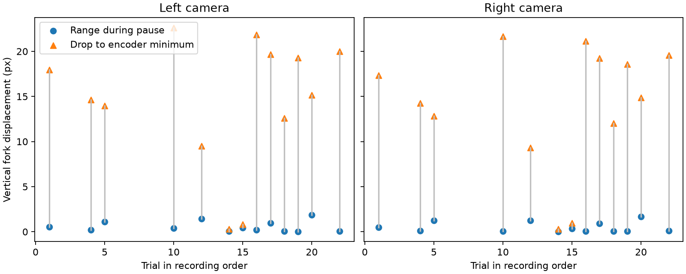

# A pause before the last part of the descent

Across 22 docked fork lowers to 52 mm, the physical encoder showed **15 near-target pauses**. The median observed pause was 172 ms (range 119–421 ms). In the eight-move duration crossover alone, seven lowers paused. This included moves that subsequently settled without reversing. A pause alone is insufficient to predict upward recovery.

The canonical MuJoCo replay produced **zero pauses in 22 lowers**, including after rounding its output to a 0.34 mm grid. The model misses an observable phase of the motion. These recordings alone cannot distinguish motor control from gearbox friction.

The test takes the longest interval of at least three consecutive SDK reports agreeing to within 0.05 mm, between 53 and 58 mm, before the encoder minimum and first in-position flag. This excludes the initial wait for motion and the final settling plateau. Durations measure the first-to-last equal report and omit uncertain fractions at both ends.

Both camera views supplied at least two valid frames inside 13 of the 15 pauses. In **11** of those, each tracked fork post stayed within 1.85 px during the pause and then moved down by over 9 px by the frame nearest the encoder minimum. In speed-crossover lower 3, the encoder held at 55.07 mm for 421 ms. Both fork posts stayed within 1 px over seven frames, then dropped 19.7 and 19.3 px. The fork subsequently recovered 3.11 mm on the encoder.

Two exceptions matter. Speed-crossover lower 1 had a subsequent encoder drop of just 0.69 mm, with less than 1 px measured in each eye. Height-crossover lower 8 reported a 7.55 mm drop but the selected optical measurements differed by only 0.3 px. That trial remains unresolved. Two other pauses had only one video frame in the interval. Frame selection uses camera and SDK receipt times and the fork template is referenced to the settled position.

[Physical trials and optical measurements](pauses.csv) · [Simulator results](sim-pauses.csv) · [Physical videos and previous crossing-speed analysis](../crossings/README.md)

Run pauses.py here with OpenCV, NumPy and Matplotlib. Run replay.py with the canonical web dependencies installed. It replays the recorded commands from all three runs, samples at each physical SDK report, and repeats the pause search after rounding simulated height to a 0.34 mm grid as a quantization sensitivity check.
