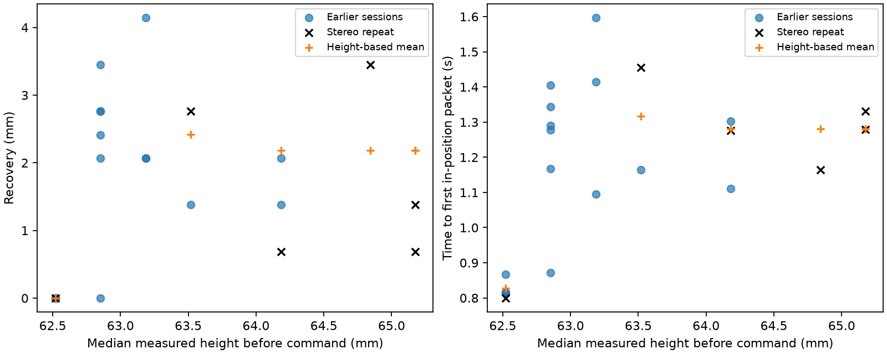

# Can starting lift height predict a reversal before lowering?

On six separately recorded stereo trials, the median physical lift height during the last 200 ms before the command predicted the first in-position packet more closely than treating all 64→52 mm lowers alike. The six trials had identical targets and requested duration. Their measured starting heights spanned 62.52–65.17 mm.

| Predictor for six held-out lowers | In-position time MAE | Recovery amplitude MAE |
|---|---:|---:|
| Mean of all 16 earlier lowers | 186 ms | 1.13 mm |
| Earlier lowers at similar physical starting height | 56 ms | 0.90 mm |
| Same method using the simulated starting height | 138 ms | 1.30 mm |

The one stereo trial starting at 62.52 mm had no observed recovery. The four historical examples at that height also had none. The other five stereo trials all reversed. The two starting at 65.17 mm recovered by 0.69 and 1.38 mm respectively. Start height helps distinguish the fast case on this sequence but does not uniquely determine the recovery amplitude.

We averaged outcomes from the four closest historical starting heights, including all ties at the cutoff after rounding heights to 0.01 mm. The historical set contains four status-session and twelve approach-history lowers. No later held-out encoder or camera packet enters the forecast. Three held-out starts exceed the historical maximum of 64.18 mm, so these estimates rely on nearest available examples. The hypotheses were developed after the six outcomes had been examined for other analyses; this is a cross-session retrospective check.

The canonical replay of the preceding raises produced one start at 65.17 mm and five at 64.51 mm. It missed the low start on the fast trial. Reproducing how the preceding raise settles is therefore a testable prerequisite for this particular predictor to transfer into the simulator. The diagnostic remains outside the canonical runtime.

[Per-trial forecasts](prelower-scores.csv) · [Physical stereo measurements](recovery/README.md) · [Earlier lowers](lower-shape.md). Run python sim_start.py with the canonical web dependencies, then python prelower.py with NumPy and Matplotlib.
