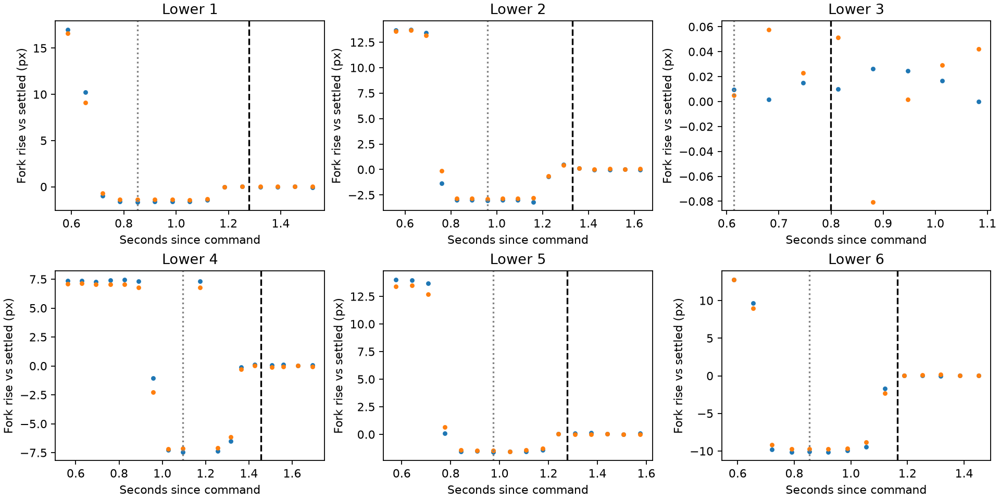

# Does the fork physically reverse on delayed lowers?

Yes on five fresh docked 64→52 mm lowers. Both rectified ZED views show the fork posts rising between the encoder minimum plateau and the first lift-in-position packet. On the sixth, faster response the two images stayed within 0.05 px of their starting height over the corresponding interval. All six commands requested 0.6 s duration. All 441 SDK packets reported dock contact, and the platform still reported true with the lift lowered afterward.

| Lower | First in-position (s) | Encoder rise (mm) | Left image rise (px) | Right image rise (px) |
|---|---:|---:|---:|---:|
| 1 | 1.279 | 0.69 | 1.68 | 1.41 |
| 2 | 1.330 | 1.38 | 3.16 | 3.01 |
| 3 | 0.799 | 0.00 | 0.00 | 0.05 |
| 4 | 1.455 | 2.76 | 7.56 | 7.15 |
| 5 | 1.275 | 0.69 | 1.68 | 1.47 |
| 6 | 1.165 | 3.45 | 10.08 | 9.74 |

The dotted line marks the camera frame nearest the midpoint of the first minimum plateau. The dashed line is the first in-position SDK report after deassertion. Orange and blue show independent image measurements at opposite fork posts. We matched a settled fork patch backwards and forwards in a local window, interpolating the vertical correlation peak. Endpoint correlations exceeded 0.97 in every trial. Fixed dock patches moved less than 0.05 px from their reference. Tread patch displacements between endpoints were below 0.12 px in both views. Motion was measured in image pixels without using an encoder-to-camera height calibration. The encoder selected the comparison times. One camera frame spans roughly 67 ms; sub-frame timing and absolute 3D amplitudes remain unmeasured.

The [previous canonical replay](../lower-shape.md) bottomed at 51.64 mm for these nominal moves. The physical evidence now supports modeling an actual reversal of the fork; the drive mechanism responsible remains open.

[Rectified video](lift.mp4) · [Example fork and dock patches](landmarks.jpg) · [All endpoints and controls](summary.csv) · [Encoder, gyro and status](sdk.csv). Run python analyze.py here with NumPy, OpenCV and Matplotlib.
