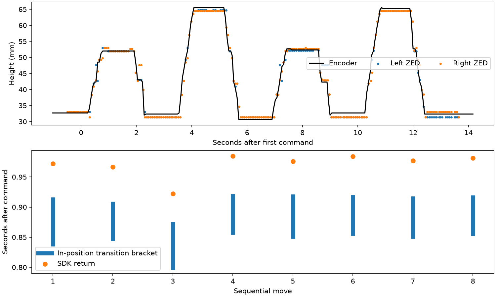

# When does the docked lift report it has settled?

Eight new physical moves repeated the [previous sequence](../canonical.md) and added the lift-in-position status bit to the SDK recording. The previously slow 64→32 mm lower returned in 985 and 981 ms this time. The earlier 1,220 ms observation remains unexplained because its recording omitted this bit.

Across the eight moves the first in-position packet after deassertion arrived 872–918 ms after the command. The SDK return followed that packet by 50–67 ms (median 62 ms). This is receipt timing; the blue segment spans the last false and first true packets. It cannot locate the firmware transition more precisely.

The frozen 850 ms simulator completion had 120 ms mean absolute error here. Adding the 125.3 ms return correction previously estimated from the first session reduced that to 11 ms. These moves repeat the same targets, duration and robot; further tests need to cover the delayed-return cases before applying a general correction.

We also reused the two visual template banks from the first session without recalibration. On 213 new stereo frames, left/right height MAE against interpolated SDK encoder readings was 1.12/1.07 mm overall and 1.83/1.71 mm over the 72 frames moving faster than 5 mm/s. Optical estimates share the first session's encoder calibration. All 254 robot-state packets reported dock contact. The lift was lowered and the platform flag verified after the experiment.

[Rectified stereo recording](lift.mp4) · [Raw SDK fields with relative receipt times](sdk.csv) · [Per-move intervals](moves.csv). Run python analyze.py from here with NumPy, Matplotlib and OpenCV to reproduce the comparison.
