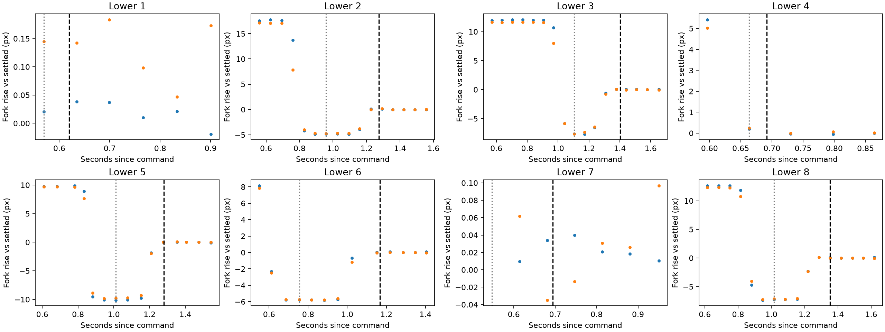

# Does a slower lift command reduce overshoot?

All four 0.8 s lowers reversed upward on the way to settling. One of four 0.4 s lowers reversed. Both ZED views confirmed each of the five reversals. The canonical replay predicted zero recovery in all eight cases.

We held preparation at 64 mm in 0.6 s and the lower target at 52 mm. Adjacent pairs compared short/long, long/short, long/short, short/long requests. The physical encoder still varied at the start. At the same measured 62.52 mm start, all three long requests reversed (2.07–3.11 mm), and one of two short requests reversed (0 and 2.42 mm). Two successive lowers started at 65.17 mm: the short request showed no recovery, the long one rose 3.45 mm.

| Quantity, median of four | 0.4 s request | 0.8 s request |
|---|---:|---:|
| Encoder speed over middle 60% of travel | 58.1 mm/s | 14.6 mm/s |
| First lift-in-position packet after command | 0.693 s | 1.316 s |
| Time beyond requested duration | 0.293 s | 0.516 s |
| Upward recovery by first in-position packet | 0 mm | 2.93 mm |

Speed uses linearly interpolated threshold crossings from SDK reports. It is an average through part of the stroke; individual short strokes cross most of that interval within very few packets. The near-target motor speed and controller output remain unmeasured. The results argue against treating recovery as a simple increasing function of average downward speed.

Dotted markers locate the encoder minimum plateau; dashed markers mark the first in-position report. Across the five moves with recovery, the smaller of the two optical rises was at least 4.89 px. Tread controls moved less than 0.12 px. All 499 SDK packets asserted dock contact. The fork was lowered after the recording and dock presence verified.

[Rectified stereo video](lift.mp4) · [Measured speed and recovery](speed-scores.csv) · [Simulated responses](sim.csv) · [Previous height crossover](../height-crossover/README.md). Run python speed.py and python sim.py from this directory with the standard analysis and web dependencies.
