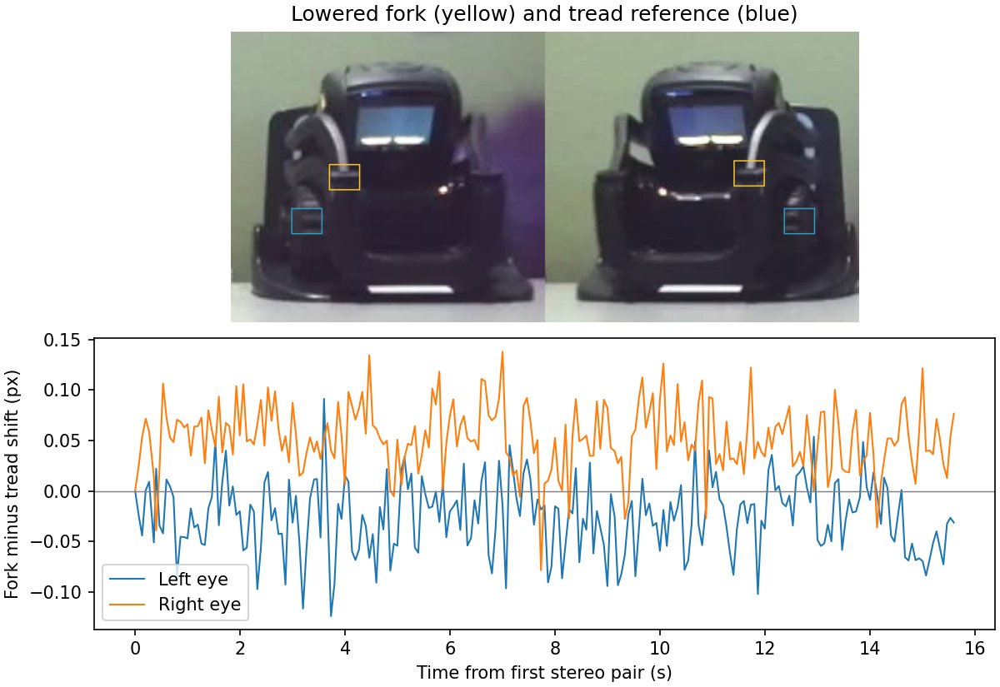

# Stationary fork in the workshop ZED

The workshop robot remained on the workshop dock for a passive recording on November 27. Preflight reported 3.549 V, stationary, asleep, on the platform and no active charging. The run issued no robot commands. The ZED 2 captured 235 stereo pairs spanning 15.59 seconds after warmup.

In each eye, we tracked vertical displacement of a lowered fork post and a tread landmark by normalized template correlation with a subpixel peak estimate. The plot subtracts tread motion and references the first frame. Minimum correlation across all four patches was 0.935. The 95th percentile absolute fork displacement relative to the tread was 0.088 px left and 0.106 px right. Absolute maxima were 0.124 and 0.138 px. The sample is one continuous stationary sequence. It measures repeatability at this pose. It cannot bound moving-fork blur or SDK–camera timing error.

The earlier right-eye fork drops of about 19–22 px are much larger than this stationary variation. This comparison supports genuine motion during those events but does not identify the cause of the lift pause.

[Robot-only stereo video](rest.mp4) · [Frame times](rest-camera.csv) · [Displacements and correlations](motion.csv) · [Tracking script](measure.py) · [Previous target crossover](../target-crossover/README.md)

Rectification and crop follow the [existing camera script](../crossings/crop_rest.py). Run measure.py beside the video and frame times with OpenCV, NumPy and Matplotlib.
