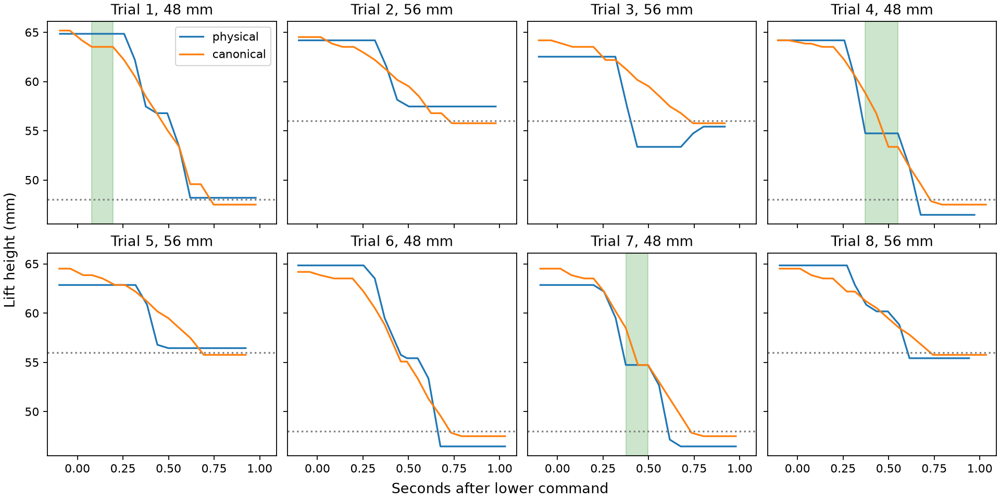

# Does the lift pause at the same height when the target changes?

Eight fresh docked lowers alternated 48 and 56 mm targets in balanced order. Each followed a 64 mm preparation command. All requests specified 0.6 s. Two of the four 48 mm lowers paused at the same reported height, **54.73 mm**, for 179 and 121 ms. The other two passed through it. The four 56 mm lowers had no qualifying pause. Only one of those four descended as far as 54.73 mm, so this does not rule out a position-dependent mechanical effect.

The fixed-height repeats matter because the final targets were 6.73 mm below the pause. At the same height a 52 mm target would be only 2.73 mm away. This puts some real pauses outside the 1–6 mm search band in the preceding experiment. Both the commanded travel and the requested velocity profile change when the endpoint moves. The result does not establish a fixed bind point or identify motor torque.

The score takes the longest run of three or more encoder packets within 0.05 mm of the first, after at least 1 mm descent, at least 1 mm above target, and with at least 1 mm of further travel before the first in-position flag. We applied the same rule to both physical and simulated traces. MuJoCo had one qualifying pause, at 63.52 mm near the start of trial 1, and none at the observed 54.73 mm height. Physical and simulated in-position flags landed on the same sampled packet in five of eight lowers. Agreement at completion can conceal an error within the stroke.

The ZED captured 419 rectified robot-cropped pairs. The left and right fork posts each moved less than 1 px across the frames inside each measured pause. The right post subsequently dropped 18.8 and 21.6 px respectively. Both left-eye minimum-height matches fell below the 0.85 correlation threshold and are marked missing. The cameras sample at approximately 15 Hz. The two physical pauses contain only three and two frames.

All 493 SDK state packets reported dock contact. The fork returned to 31.32 mm, and the platform flag was true before and after at 3.549 V. No wheel commands were issued. The SDK records report position and velocity-related state; they contain no measured lift motor duty or current. Earlier wheelstand effort sweeps reported simulated torque. The reference firmware guards its power diagnostic with DEBUG_LIFT_CONTROLLER, disabled by default. These results use camera and encoder observations.

[Rectified stereo clip](lift.mp4) · [Physical SDK samples](sdk.csv) · [Frame times](camera.csv) · [Canonical replay](replay.csv) · [Pause scores](scores.csv) · [Optical measurements](optical.csv) · [Earlier 52 mm lowers](../pauses/README.md).

Run replay.py with the canonical web dependencies installed, then analyze.py and optical.py with NumPy, Matplotlib and OpenCV.
