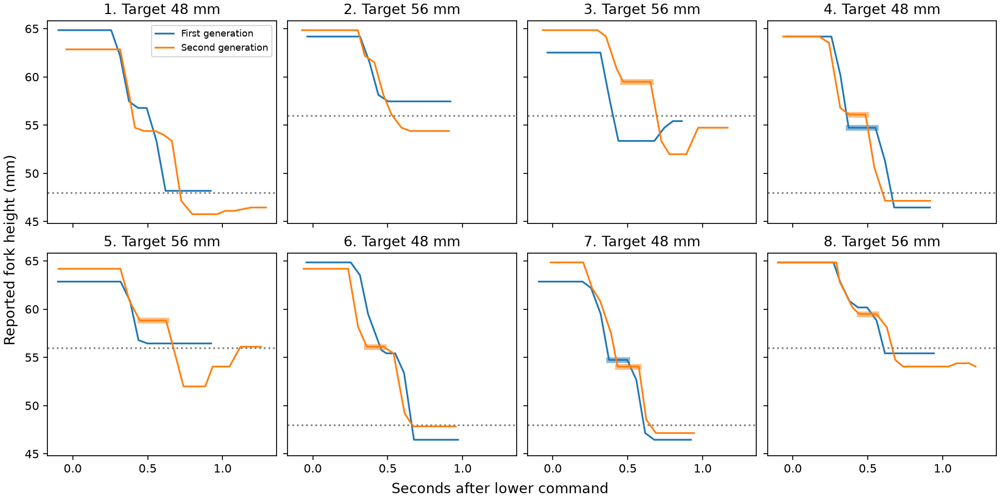
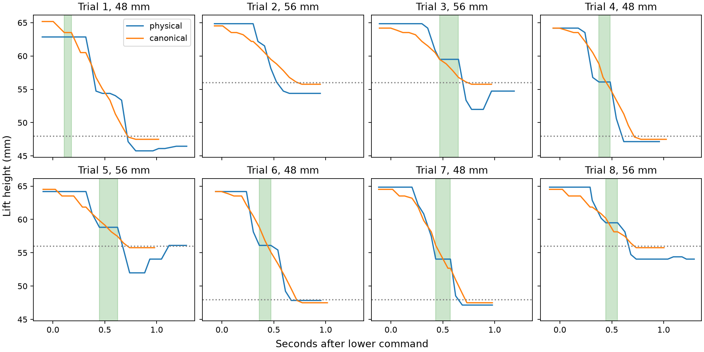

# Held-out docked lowers on the second-generation Vector

The second robot ran the same balanced sequence of eight 0.6 s lowers from a commanded 64 mm preparation. We froze the encoder pause rule from the [first-generation stereo crossover](../target-crossover/README.md). Six of eight new strokes contained a qualifying pause, compared with two of eight on the first robot. One robot represents each generation. The second has a printed fork and its grip was previously reported damaged. These unloaded observations support a cross-unit comparison; they cannot isolate the effect of hardware generation.

| Requested endpoint | First robot, pause heights (mm) | Second robot, pause heights (mm) | Median command-to-in-position time, first / second |
|---|---|---|---|
| 48 mm | 54.73, 54.73 | 56.10, 56.10, 54.05 | 0.859 / 0.866 s |
| 56 mm | None | 59.50, 58.82, 59.50 | 0.858 / 1.130 s |

The second robot's six pauses lasted 109–182 ms. Its two sets of measured pause heights do not overlap, although the initial measured height and the commanded motion profile also varied. A single absolute obstruction height cannot account for all its observed encoder pauses. With one robot per setup, small groups, and no independent optical or motor-effort measurement on the second unit, the causes remain open.

The canonical replay registered one early pause at 63.52 mm in trial 1, and missed all six physical pauses. It reuses the same docked model and control settings as the prior crossover. It starts from the recorded joint positions and samples state at the new SDK receipt times. Hardware-specific fork mass and gearbox properties were not fitted.

All 511 fresh SDK states reported dock contact. The fork ended low at 33.02 mm and post-run battery telemetry confirmed platform contact at 3.593 V. [SDK samples](sdk.csv) · [MuJoCo replay samples](replay.csv) · [Frozen scores](scores.csv) · [Cross-unit measurements](transfer.csv).

From this directory run python ../target-crossover/replay.py . and python ../target-crossover/analyze.py, then python compare.py. Use the canonical web dependencies and NumPy and Matplotlib.
