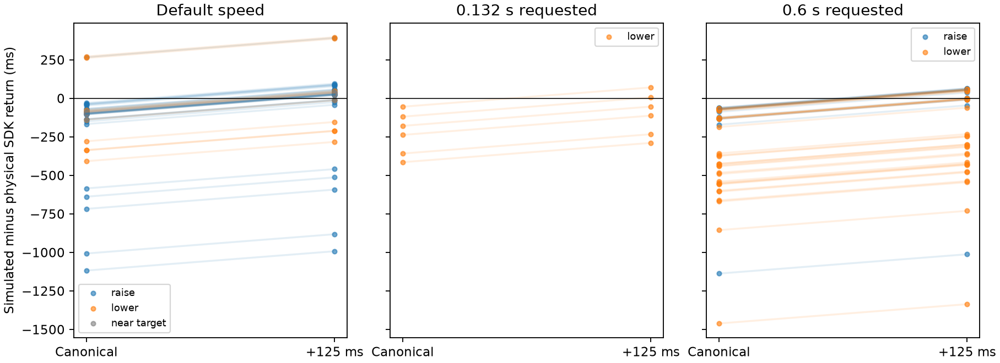

# Does the stereo-run completion correction transfer?

We froze the 125.3 ms completion offset from the first four stereo moves and applied it to four separate docked sessions on the same robot. The score includes all 103 recorded SDK commands with matching canonical returns, including default-speed setup and cleanup actions. No motion or return time in these four sessions was used to choose the offset. Targets, move directions and starting histories differ between groups.

| Group | Commands | Canonical return MAE | With frozen offset |
|---|---:|---:|---:|
| All commands | 103 | 249 ms | 178 ms |
| 132 ms lowers | 6 | 227 ms | 128 ms |
| 600 ms raises | 16 | 154 ms | 105 ms |
| 600 ms lowers | 34 | 365 ms | 264 ms |

The correction worsened 11 individual commands. The 600 ms lowers still returned a median 247 ms too early. The [eight-move stereo repeat](settle/README.md) had a much smaller corrected error, 11 ms.

Two of these archived sessions also captured the lift-in-position bit. For 49 moves with more than 2 mm requested displacement and an observed false→true transition, we replaced the predicted completion with the **first physical in-position packet plus 62 ms**, the previously observed stereo-run median packet-to-return delay rounded to milliseconds. Mean absolute return error on the same 49 moves fell from **269 ms** using the corrected autonomous simulator to **5.4 ms** using this diagnostic. The flag is a physical input to this check. The result localizes the bulk of the discrepancy to predicting *when* the lift reports in position. Predicting that event from simulated mechanics and controller state remains open.

[103 command scores](transfer-scores.csv) · [49 physical flag checks](flag-control.csv). Run python transfer.py from this directory with NumPy and Matplotlib installed.
